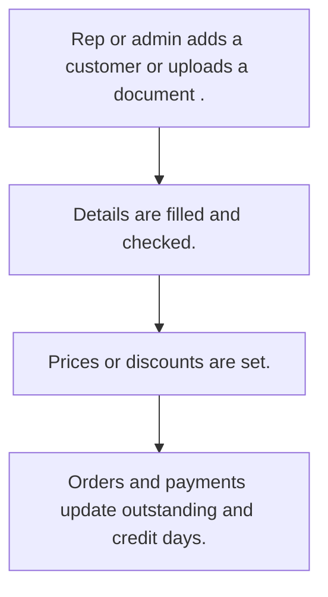

# Customer master

## Usual needs

- Usually has to keep customers with contact, tax ID, address, place and category.
- Usually has to keep several contacts and shipping addresses per customer.
- Usually has to keep a price or discount per customer for products or categories.
- Usually has to track credit limit, credit days and outstanding amount.
- Usually has to let reps see their own customers and managers see all.
- Usually has to sometimes read customer details from an uploaded document.

## Process steps

1. Rep or admin adds a customer (or uploads a document).
2. Details are filled and checked.
3. Prices or discounts are set.
4. Orders and payments update outstanding and credit days.

## Usual sheets, key fields, roles

- Customer: Name, ContactPerson, Mobile, Email, tax ID, Address, place refs, Category, discount or price grid, CreditAmount, CreditDays, OutstandingAmount (log), Status
- Roles: Sales rep, Manager, Admin, sales coordinator.

## Neome App / Delivery hint

Neome App: crm. Delivery: configuration. Hint only; grilling decides.

## Flowchart

## Execute

Only use this to apply this into a Studio Enterprise via MCP.

Placeholders: CustomerSheet, StateSheet, CitySheet, ProductSheet, VarCustomerCategory, VarCustomerStatus. Needs first: ProductSheet for prices (TMOD-product-catalog); if Neome App crm is installed, reuse its customer sheet.

1. Roles + vars: `add kind=role` SalesRep, Manager, Admin, SalesCoordinator; `add kind=var kind=setOfText` VarCustomerCategory, VarCustomerStatus.
2. Places: apply PAT-chained-place-lists Execute (StateSheet → CitySheet refs).
3. Customer: `add kind=form` → `kind=composite type=section` → CustomerId `type=identifier` (PAT-generated-id), Name, ContactPerson `type=text`, Mobile `type=mobileNumber`, Email `type=email`, TaxId `type=text validationPattern={value:gstin}`, Address `type=paragraph`, State, City `type=ref`, Category `type=pickText`, CreditAmount `type=decimal`, CreditDays `type=number`, OutstandingAmount `type=logDecimal`, Status `type=pickText`.
4. Grids: `kind=composite type=grid` Contacts (name, mobile, email) + ShippingAddresses → `add kind=spreadsheet` (`searchables=[Name, Mobile]`) → `kind=spreadsheetLayout kind=table` + `kind=list`.
5. Prices: apply PAT-customer-price-list Execute. Copy fields: PAT-copy-fields-from-ref.
6. Outstanding: apply PAT-running-total-by-log-field Execute (orders, payments); credit days job: PAT-scheduled-job-over-rows.
7. Read from document, only if asked: PAT-ai-reads-into-form.
8. Views: apply PAT-role-views-of-one-sheet Execute (SalesRep own; Manager, Admin all).
9. Actions + group: `kind=rowInsert` + `kind=spreadsheetEditor` per view → `set kind=group actionPermissionMap`.
10. `validate` till ok=true. `describe` sheet.

Gaps: tax ID pattern depends on country; "own customers" condition var (verify: describe).
