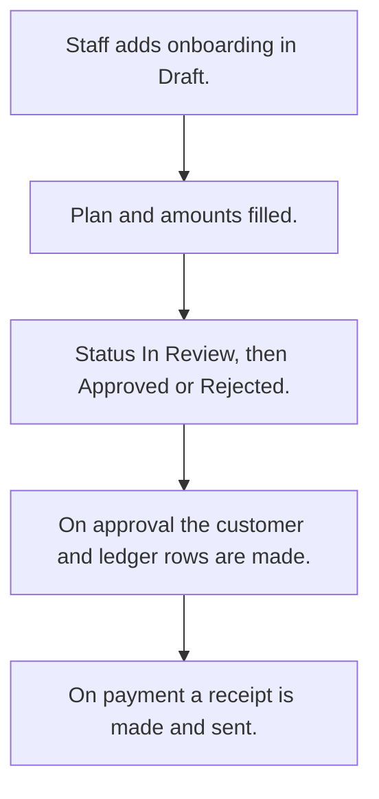

# Customer onboarding

## Usual needs

- Usually has to sign up a new customer with contact, ID documents, photo and signature.
- Usually has to pick a plan, start date and duration; work out rent, deposit and total.
- Usually has to take payment by cash or online and make a receipt.
- Usually has to review and approve or reject the sign-up.
- Usually has to create the customer and a first ledger row on approval.
- Usually has to tell the customer on approval and on payment.

## Process steps

1. Staff adds onboarding in Draft.
2. Plan and amounts filled.
3. Status In Review, then Approved or Rejected.
4. On approval the customer and ledger rows are made.
5. On payment a receipt is made and sent.

## Usual sheets, key fields, roles

- Onboarding: Branch, CustomerName, Mobile, City, ID documents, Plan, duration, amounts, PaymentMode, PaymentStatus, Receipt, Signature, Status {Draft|In Review|Approved|Rejected}
- Roles: Employee.

## Neome App / Delivery hint

Neome App: none in the catalog. Delivery: configuration. Hint only; grilling decides.

## Flowchart

## Execute

Only use this to apply this into a Studio Enterprise via MCP.

Placeholders: OnboardingSheet, PlanSheet, CustomerSheet, LedgerSheet, VarOnboardingStatus, VarPaymentMode, VarBranch. Needs first: Customer sheet (TMOD-customer-master), ledger (TMOD-customer-account-ledger), Plan sheet (RentalPlanSheet from TMOD-rental-customer-and-fleet when rental; else Open Item).

1. Roles + vars: `add kind=role` Employee; `add kind=var kind=setOfText` VarOnboardingStatus (Draft, In Review, Approved, Rejected), VarPaymentMode, VarBranch.
2. Form: `add kind=form` → `kind=composite type=section` Customer → Branch `type=pickText source=VarBranch`, CustomerName `type=text`, Mobile `type=mobileNumber`, City `type=text`, IdDocuments `type=setOfDocument`, Photo `type=camera`, Signature `type=signature`.
3. Plan section: Plan `type=ref spreadsheet=PlanSheet layoutSpreadsheet=<list>`, StartDate `type=date`, Duration `type=number`, Rent, Deposit, Total `type=decimal`. Payment section: PaymentMode `type=pickText`, PaymentStatus `type=paymentStatus`, Receipt `type=document`, Status `type=pickText source=VarOnboardingStatus`.
4. Sheet: `add kind=spreadsheet form=OnboardingForm` → `kind=spreadsheetLayout kind=table`.
5. Logic: apply PAT-calculated-field (amounts), PAT-show-field-by-value (payment fields by mode), PAT-copy-fields-from-ref, PAT-photo-and-document-capture Execute.
6. Approve: apply PAT-approval-by-status + PAT-insert-row-in-other-sheet Execute (Approved → `rowInsert spreadsheet=CustomerSheet`, then `rowInsert spreadsheet=LedgerSheet`); tell customer: PAT-message-on-event.
7. Payment: apply PAT-online-payment-event Execute (form `payment.enablePaymentV2`, `eventPaymentReceipt`); receipt: PAT-pdf-from-report (`generatePdf outputField=Receipt`) and send.
8. Actions + group: `kind=rowInsert` + `kind=spreadsheetEditor` → `set kind=group actionPermissionMap` (Employee).
9. `validate` till ok=true. `describe` form, sheet, workflows.

Gaps: online payment needs a payment provider on the Enterprise (verify: describe).
