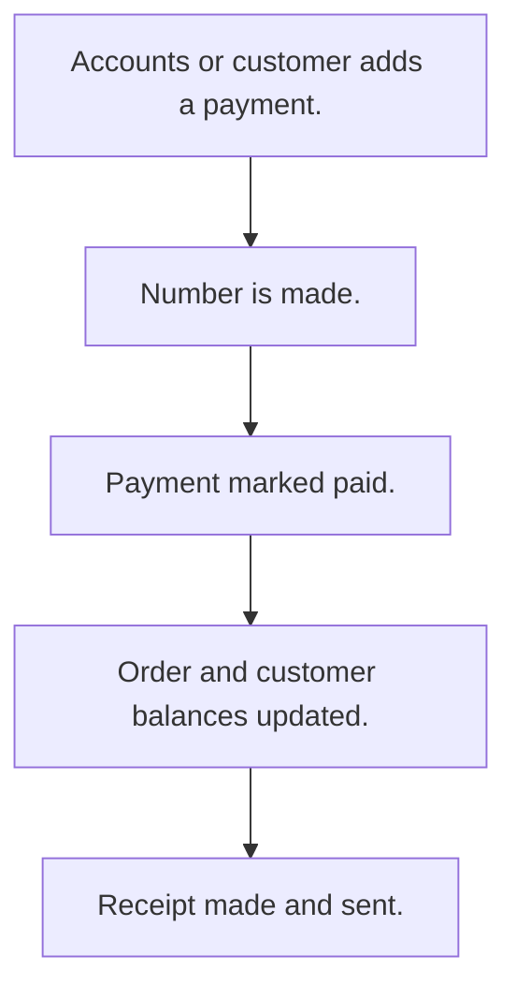

# Customer payments

## Usual needs

- Usually has to record a payment from a customer against an order or account.
- Usually has to keep payment mode, reference and documents.
- Usually has to update the order due amount and the customer balance.
- Usually has to make a receipt PDF and tell the customer.
- Usually has to sometimes take online payments and mark them paid on their own.

## Process steps

1. Accounts or customer adds a payment.
2. Number is made.
3. Payment marked paid.
4. Order and customer balances updated.
5. Receipt made and sent.

## Usual sheets, key fields, roles

- Payment: PaymentId, Date, Customer, Order or plan ref, Amount, PaymentMode {Cash|UPI|Bank Transfer|Cheque|Online}, PaymentStatus {Pending|Paid}, Documents, Receipt
- Roles: Accounts, Employee, Customer.

## Neome App / Delivery hint

Neome App: none in the catalog. Delivery: configuration. Hint only; grilling decides.

## Flowchart

## Execute

Only use this to apply this into a Studio Enterprise via MCP.

Placeholders: PaymentSheet, CustomerSheet (balance `type=logDecimal`), OrderSheet (DueAmount `type=logDecimal`), VarPaymentMode, VarPaymentStatus. Needs first: Customer sheet with log balance (TMOD-customer-master), OrderSheet (TMOD-sales-order; its DueAmount is `type=decimal`, change to `type=logDecimal`).

1. Roles + vars: `add kind=role` Accounts, Employee, Customer; `add kind=var kind=setOfText` VarPaymentMode (Cash, UPI, Bank Transfer, Cheque, Online), VarPaymentStatus (Pending, Paid).
2. Payment: `add kind=form` → `kind=composite type=section` → PaymentId `type=identifier` (PAT-generated-id), Date `type=date`, Customer `type=ref spreadsheet=CustomerSheet layoutSpreadsheet=<list>`, Order `type=ref spreadsheet=OrderSheet`, Amount `type=decimal`, PaymentMode `type=pickText`, Reference `type=text`, PaymentStatus `type=pickText`, Documents `type=setOfDocument`, Receipt `type=document` → `add kind=spreadsheet` → `kind=spreadsheetLayout kind=table`.
3. Logic: apply PAT-copy-fields-from-ref, PAT-photo-and-document-capture Execute. Save check (rule from user): PAT-stop-save-by-workflow-check.
4. Paid: apply PAT-act-on-status-change + PAT-running-total-by-log-field Execute (`eventSsUpdateAfter spreadsheet=PaymentSheet` → `branchIfElse` Paid → `rowUpdateFieldLogNumber operation=subtract` on order due and customer balance).
5. Receipt: apply PAT-pdf-from-report Execute (`generatePdf outputField=Receipt`); send: PAT-message-on-event.
6. Online, only if asked: PAT-online-payment-event; gateway: PAT-outside-service-by-plugin.
7. Actions + group: `kind=rowInsert` (Accounts, Customer), `kind=spreadsheetEditor` (Accounts, Employee) → `set kind=group actionPermissionMap`.
8. `validate` till ok=true. `describe` sheet + workflows.

Gaps: gateway plugin is import only.
