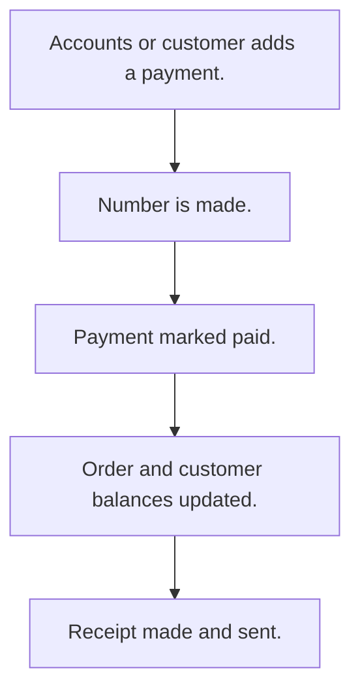

# Customer payments

## Usual needs

- Usually has to record a payment from a customer against an order or account.
- Usually has to keep payment mode, reference and documents.
- Usually has to update the order due amount and the customer balance.
- Usually has to make a receipt PDF and tell the customer.
- Usually has to sometimes take online payments and mark them paid on their own.

## Process steps

1. Accounts or customer adds a payment.
2. Number is made.
3. Payment marked paid.
4. Order and customer balances updated.
5. Receipt made and sent.

## Usual sheets, key fields, roles

- Payment: PaymentId, Date, Customer, Order or plan ref, Amount, PaymentMode {Cash|UPI|Bank Transfer|Cheque|Online}, PaymentStatus {Pending|Paid}, Documents, Receipt
- Roles: Accounts, Employee, Customer.

## Neome App / Delivery hint

Neome App: none in the catalog. Delivery: configuration. Hint only; grilling decides.

## Flowchart

