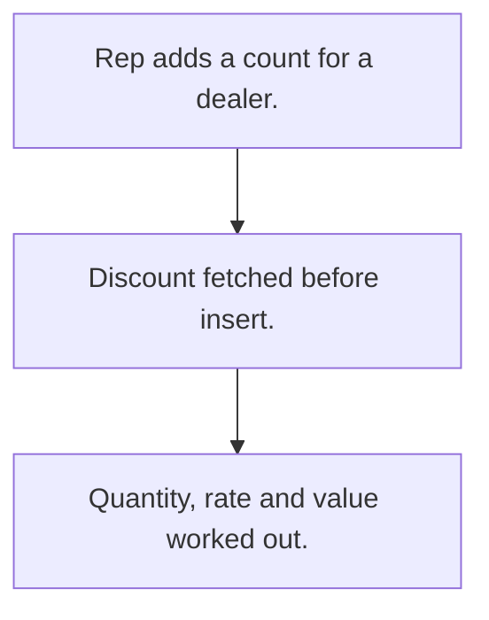

# Dealer stock count

## Usual needs

- Usually has to let a rep count stock held by a dealer by product.
- Usually has to apply the dealer's discount to the rate and work out the value.
- Usually has to report by dealer, month and product.
- Usually has to list dealers missing a count.

## Process steps

1. Rep adds a count for a dealer.
2. Discount fetched before insert.
3. Quantity, rate and value worked out.

## Usual sheets, key fields, roles

- Stock count: Date, EnteredBy, Customer, product grid (Product, Quantity, Discount, Rate, Total), FinalAmount
- Roles: Sales rep, Manager, Admin.

## Neome App / Delivery hint

Neome App: fmcg-field-sales-and-distribution. Delivery: configuration. Hint only; grilling decides.

## Flowchart

## Execute

Only use this to apply this into a Studio Enterprise via MCP.

Placeholders: StockCountSheet, CustomerSheet, ProductSheet. Needs first: Customer sheet + dealer discounts (TMOD-customer-master), ProductSheet (TMOD-product-catalog); if Neome App fmcg-field-sales-and-distribution is installed, reuse it.

1. Roles: `add kind=role` SalesRep, Manager, Admin.
2. Count: `add kind=form` → `kind=composite type=section` → Date `type=date`, EnteredBy `type=userId defaultValue=createdBy`, Customer `type=ref spreadsheet=CustomerSheet layoutSpreadsheet=<list>`, FinalAmount `type=decimal` → `kind=composite type=grid` Products → Product `type=ref spreadsheet=ProductSheet`, Quantity `type=number`, Discount, Rate, Total `type=decimal` → `add kind=spreadsheet` (`queryables=[Customer, Date]`) → `kind=spreadsheetLayout kind=table`.
3. Discount + rate: apply PAT-customer-price-list + PAT-copy-fields-from-ref Execute (discount fetched before insert).
4. Totals: apply PAT-line-items-grid-with-totals Execute (`formFormula assignToField=Products.Total`; FinalAmount `SUM(${f:Products.Total})`).
5. Reports: apply PAT-composite-report Execute (by dealer, month, product; dealers missing a count).
6. Actions + group: `kind=rowInsert` (SalesRep), `kind=spreadsheetEditor` + `kind=report` (Manager, Admin) → `set kind=group actionPermissionMap`.
7. `validate` till ok=true. `describe` sheet + reports.

Gaps: "dealers missing a count" needs a query report over customers (verify: describe).
