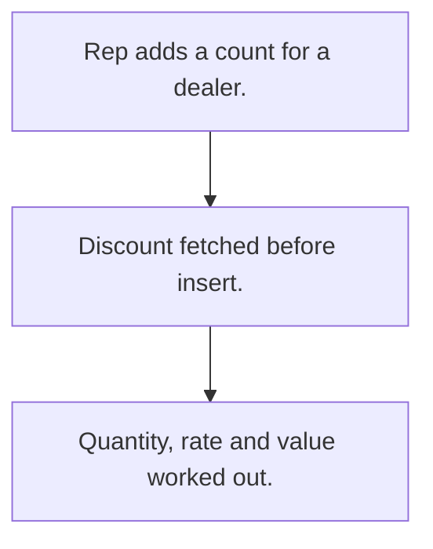

# Dealer stock count

## Usual needs

- Usually has to let a rep count stock held by a dealer by product.
- Usually has to apply the dealer's discount to the rate and work out the value.
- Usually has to report by dealer, month and product.
- Usually has to list dealers missing a count.

## Process steps

1. Rep adds a count for a dealer.
2. Discount fetched before insert.
3. Quantity, rate and value worked out.

## Usual sheets, key fields, roles

- Stock count: Date, EnteredBy, Customer, product grid (Product, Quantity, Discount, Rate, Total), FinalAmount
- Roles: Sales rep, Manager, Admin.

## Neome App / Delivery hint

Neome App: fmcg-field-sales-and-distribution. Delivery: configuration. Hint only; grilling decides.

## Flowchart

