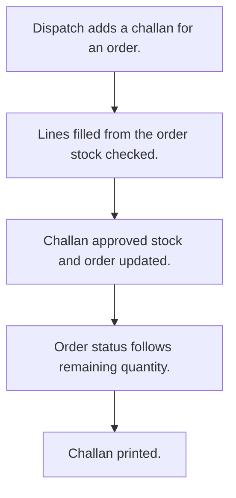

# Dispatch

## Usual needs

- Usually has to send goods against an approved order from a warehouse.
- Usually has to pick order lines with ordered, sent and available quantity.
- Usually has to stop a dispatch above stock on hand.
- Usually has to cut stock and add sent quantity to the order on approval.
- Usually has to set order status to part dispatched or delivered.
- Usually has to cancel a dispatch and put stock back.
- Usually has to print the challan and mark it printed.
- Usually has to list pending dispatch and short items.

## Process steps

1. Dispatch adds a challan for an order.
2. Lines filled from the order; stock checked.
3. Challan approved; stock and order updated.
4. Order status follows remaining quantity.
5. Challan printed.

## Usual sheets, key fields, roles

- Dispatch: Date, Order ref, Warehouse, lines (Item, OrderQty, DispatchQty, Available), Status {Pending|Approved|Rejected} or {Pending|In transit|Delivered|Cancelled}, Cancel flag
- Roles: Dispatch or inventory staff, Accounts, Admin.

## Neome App / Delivery hint

Neome App: quotation-and-order-flow. Delivery: configuration. Hint only; grilling decides.

## Flowchart

## Execute

Only use this to apply this into a Studio Enterprise via MCP.

Placeholders: DispatchSheet, OrderSheet, StockSheet, WarehouseSheet, VarDispatchStatus. Needs first: OrderSheet with sent quantity log fields (TMOD-sales-order), StockSheet with log quantity per item and warehouse (TMOD-inventory), WarehouseSheet (TMOD-master-data); if Neome App quotation-and-order-flow is installed, reuse it.

1. Roles + vars: `add kind=role` DispatchStaff, Accounts, Admin; `add kind=var kind=setOfText` VarDispatchStatus (pick one status set with user).
2. Dispatch: `add kind=form` → `kind=composite type=section` → Date `type=date`, Order `type=ref spreadsheet=OrderSheet layoutSpreadsheet=<list>`, Warehouse `type=ref spreadsheet=WarehouseSheet`, Status `type=pickText source=VarDispatchStatus`, Cancel, Printed `type=bool` → `kind=composite type=grid` Lines → Item `type=text`, OrderQty, DispatchQty, Available `type=number` → `add kind=spreadsheet` → `kind=spreadsheetLayout kind=table`.
3. Lines: apply PAT-pick-from-report-ref + PAT-copy-fields-from-ref Execute (order lines with ordered, sent, available).
4. Stock check: apply PAT-stop-save-by-workflow-check Execute (`eventSsInsertBefore spreadsheet=DispatchSheet` → `validate` DispatchQty not above Available → `stopAndError`).
5. Approve: apply PAT-approval-by-status + PAT-stock-moves-by-workflow Execute (`branchIterateGrid grid=Lines` → `rowUpdateFieldLogNumber` stock subtract, order sent add). Order status: PAT-status-from-quantities.
6. Cancel: apply PAT-undo-on-cancel Execute (stock back).
7. Print: apply PAT-button-runs-workflow Execute (`generatePdf` challan → `rowUpdate` Printed).
8. Reports: PAT-query-report-with-filter (pending dispatch, short items).
9. Actions + group: `kind=rowInsert` + `kind=spreadsheetEditor` (DispatchStaff), `kind=report` (Accounts, Admin) → `set kind=group actionPermissionMap`.
10. `validate` till ok=true. `describe` sheet + workflows.

Gaps: `validate` node condition over grid rows (verify: describe).
