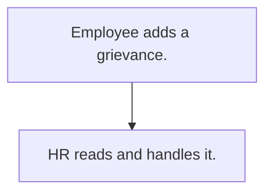

# Employee grievance

## Usual needs

- Usually has to let any employee raise a grievance with type, description, date and evidence.
- Usually has to let only HR and owner read all; the employee sees own.

## Process steps

1. Employee adds a grievance.
2. HR reads and handles it.

## Usual sheets, key fields, roles

- Grievance: Employee, Type, Description, DateOfIncident, Evidence, PreferredResolution
- Roles: Employee, HR, Owner.

## Neome App / Delivery hint

Neome App: none in the catalog. Delivery: configuration. Hint only; grilling decides.

## Flowchart

