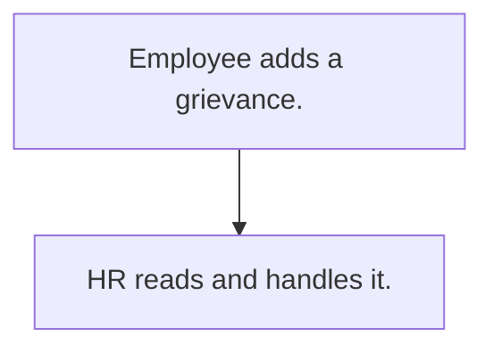

# Employee grievance

## Usual needs

- Usually has to let any employee raise a grievance with type, description, date and evidence.
- Usually has to let only HR and owner read all; the employee sees own.

## Process steps

1. Employee adds a grievance.
2. HR reads and handles it.

## Usual sheets, key fields, roles

- Grievance: Employee, Type, Description, DateOfIncident, Evidence, PreferredResolution
- Roles: Employee, HR, Owner.

## Neome App / Delivery hint

Neome App: none in the catalog. Delivery: configuration. Hint only; grilling decides.

## Flowchart

## Execute

Only use this to apply this into a Studio Enterprise via MCP.

Placeholders: GrievanceSheet, VarGrievanceType. Needs first: none.

1. Roles + vars: `add kind=role` Employee, HR, Owner; `add kind=var kind=setOfText` VarGrievanceType.
2. Grievance: `add kind=form` → `kind=composite type=section` → Employee `type=userId defaultValue=createdBy`, Type `type=pickText source=VarGrievanceType`, Description `type=paragraph`, DateOfIncident `type=date`, Evidence `type=setOfDocument`, PreferredResolution `type=paragraph` → `add kind=spreadsheet` (`insertRoles=[Employee]`, `updateRoles=[HR, Owner]`) → `kind=spreadsheetLayout kind=table`. Evidence: apply PAT-photo-and-document-capture Execute.
3. Views: apply PAT-role-views-of-one-sheet Execute (Employee: `spreadsheetEditor readOnly` + own-rows `filterCondition`; HR, Owner: all).
4. Actions + group: `kind=rowInsert` (Employee), `kind=spreadsheetEditor` per view → `set kind=group actionPermissionMap`.
5. `validate` till ok=true. `describe` sheet + group.

Gaps: own-rows condition on created-by user (verify: describe).
