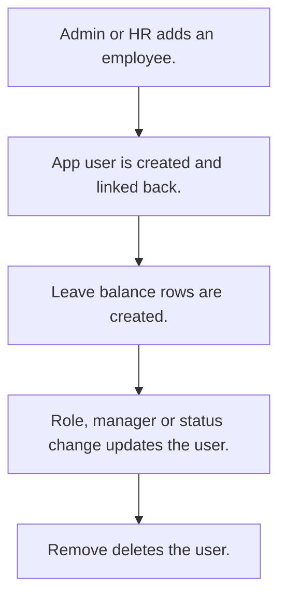

# Employee master

## Usual needs

- Usually has to keep each employee with roles, manager, team or zone, designation, branch and documents.
- Usually has to create, update and remove the app user from the employee row.
- Usually has to set an employee active or inactive.
- Usually has to keep working hours, targets and travel rates used by other modules.
- Usually has to sometimes keep job, bank and pay details for payroll.
- Usually has to create leave balance rows for a new employee.

## Process steps

1. Admin or HR adds an employee.
2. App user is created and linked back.
3. Leave balance rows are created.
4. Role, manager or status change updates the user.
5. Remove deletes the user.

## Usual sheets, key fields, roles

- Employee: Name, user (pickUser), Handle, Roles, Manager, team or zone, designation, working hours, rates, Status {Active|Inactive}
- Roles: Admin, HR.

## Neome App / Delivery hint

Neome App: employee-directory. Delivery: configuration (user nodes in workflow). Hint only; grilling decides.

## Flowchart

