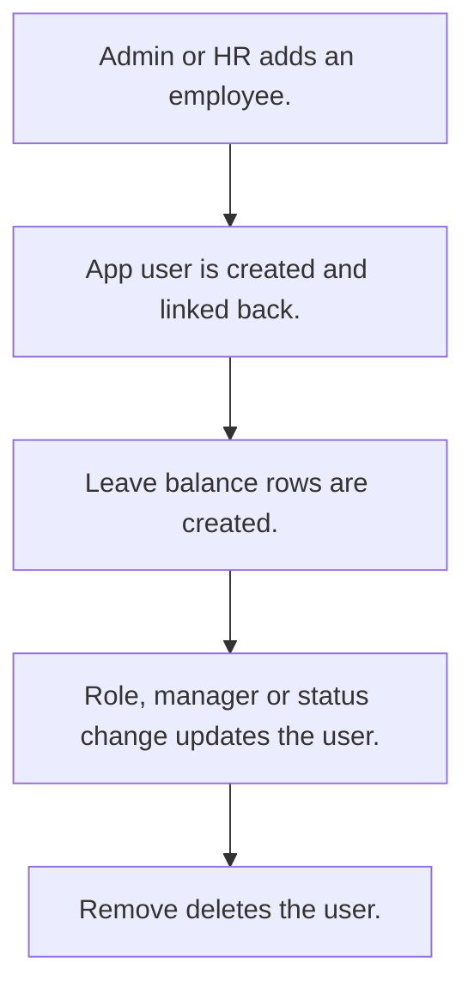

# Employee master

## Usual needs

- Usually has to keep each employee with roles, manager, team or zone, department, designation, branch and documents.
- Usually has to create, update and remove the app user from the employee row.
- Usually has to set an employee active or inactive; inactive turns the user off.
- Usually has to keep department and designation lists.
- Usually has to keep working hours, targets and travel rates used by other modules.
- Usually has to sometimes keep job, bank and pay details for payroll.
- Usually has to create leave balance rows for a new employee.
- Usually has to sometimes keep joining and exit checklists.

## Process steps

1. Admin or HR adds an employee.
2. App user is created and linked back.
3. Leave balance rows are created.
4. Role, manager or status change updates the user.
5. Remove deletes the user.

## Usual sheets, key fields, roles

- Employee: Name, user (pickUser), Handle, Roles, Manager, Department, Designation, team or zone, working hours, rates, DateOfJoining, Status {Active|Inactive}
- Department and Designation lists
- Roles: Admin, HR, Manager.

## Neome App / Delivery hint

Neome App: employee-directory. Delivery: configuration (user nodes in workflow). Hint only; grilling decides.

## Flowchart

## Execute

Only use this to apply this into a Studio Enterprise via MCP.

Placeholders: EmployeeForm, EmployeeSheet, DepartmentSheet, DesignationSheet, EmployeeWf. Needs first: none for steps 1-6, 8-10. Step 7 needs LeaveTypeSheet + LeaveRegisterSheet (TMOD-leave), and TMOD-leave needs EmployeeSheet. Run order: this Execute without step 7 → TMOD-leave Execute → step 7. If Neome App employee-directory is installed, `list` and reuse its sheets.

1. Roles + vars: `add kind=role` Admin, HR, Manager; `add kind=var kind=setOfText deploy=fixedOnDeploy` VarEmployeeStatus {Active, Inactive}.
2. Lists: `apply PAT-admin-kept-pick-list Execute` for DepartmentSheet, DesignationSheet.
3. Form: `add kind=form` EmployeeForm → `kind=composite type=section` → fields: Name `type=text`, Handle `type=mobileNumber`, User `type=pickUser roleIdDataSource=[…]`, Roles `type=setOfRole`, Manager `type=pickUser`, WorkingHours / rates `type=decimal`, DateOfJoining `type=date`, Status `type=pickText source=VarEmployeeStatus`.
4. Sheet: `add kind=spreadsheet` EmployeeSheet `form=EmployeeForm insertRoles=[Admin,HR] updateRoles=[Admin,HR]` → `kind=spreadsheetLayout kind=table` + `kind=list` → Department, Designation `type=ref layoutSpreadsheet=<list>`.
5. User sync: `apply PAT-sheet-row-drives-app-user Execute` (`eventSsInsertAfter` → `userAdd` → `rowUpdate` user back; `eventSsUpdateAfter` → `userUpdate`; `eventSsRemoveAfter` → `userRemove`).
6. Status: `apply PAT-soft-disable-by-status Execute` (Inactive → `userUpdate userActivateField`).
7. Only if TMOD-leave is in the Enterprise, after its Execute. Leave rows: `apply PAT-fan-out-rows-from-report Execute` on insert (one LeaveRegisterSheet row per leave type).
8. As needed, apply Execute: PAT-lock-fields-by-visibility, PAT-copy-fields-from-ref, PAT-calculated-field, PAT-shared-sub-workflow, PAT-device-location-trail, PAT-act-on-status-change.
9. Actions + group: `add kind=action kind=spreadsheetEditor spreadsheet=EmployeeSheet layoutSpreadsheet=<table>` (Manager copy `readOnly=true`); `PAT-composite-report` for views → `set kind=group actionPermissionMap`.
10. `validate` till ok=true. `describe` EmployeeSheet, EmployeeWf to confirm.

Gaps: `userAdd` / `userUpdate` `userRoles` binder from a setOfRole field (verify: describe). edgeMap entry keys unverified (wire 1, describe, mirror).
