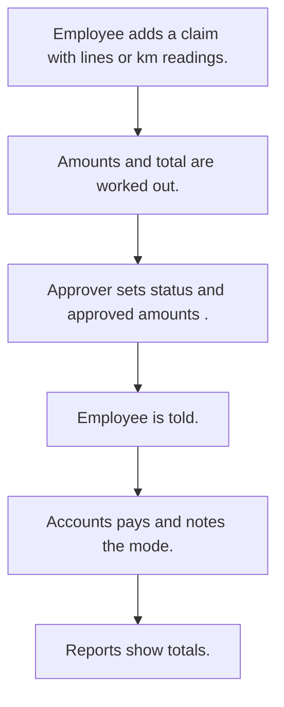

# Expense claims

## Usual needs

- Usually has to let staff claim expenses by category with amount, reason and bill photos or documents.
- Usually has to work out travel claims from start and end km and a rate per vehicle type.
- Usually has to sum many lines into a claim total.
- Usually has to let a manager, accounts or HR approve or reject, sometimes line by line.
- Usually has to tell the employee of the decision.
- Usually has to let accounts note how it was paid.
- Usually has to show totals by status, employee, month and category for a date range.

## Process steps

1. Employee adds a claim with lines or km readings.
2. Amounts and total are worked out.
3. Approver sets status (and approved amounts).
4. Employee is told.
5. Accounts pays and notes the mode.
6. Reports show totals.

## Usual sheets, key fields, roles

- Expense: Date, EnteredBy, lines (Category, Amount, Document), TotalAmount, Status {Pending|Approved|Rejected}, ModeOfPayment
- Travel claim: Date, VehicleType, StartKm, EndKm, TotalKm, TotalAmount, ApprovalStatus
- ExpenseCategory: Category
- Roles: Employee or sales rep, Manager, Accounts, HR, Admin.

## Neome App / Delivery hint

Neome App: expense-management. Delivery: configuration. Hint only; grilling decides.

## Flowchart

