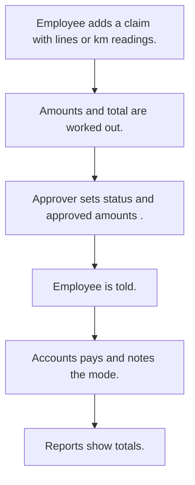

# Expense claims

## Usual needs

- Usually has to let staff claim expenses by category with amount, reason and bill photos or documents.
- Usually has to work out travel claims from start and end km and a rate per vehicle type.
- Usually has to sum many lines into a claim total.
- Usually has to let a manager, accounts or HR approve or reject, sometimes line by line.
- Usually has to tell the employee of the decision.
- Usually has to let accounts note how it was paid.
- Usually has to show totals by status, employee, month and category for a date range.

## Process steps

1. Employee adds a claim with lines or km readings.
2. Amounts and total are worked out.
3. Approver sets status (and approved amounts).
4. Employee is told.
5. Accounts pays and notes the mode.
6. Reports show totals.

## Usual sheets, key fields, roles

- Expense: Date, EnteredBy, lines (Category, Amount, Document), TotalAmount, Status {Pending|Approved|Rejected}, ModeOfPayment
- Travel claim: Date, VehicleType, StartKm, EndKm, TotalKm, TotalAmount, ApprovalStatus
- ExpenseCategory: Category
- Roles: Employee or sales rep, Manager, Accounts, HR, Admin.

## Neome App / Delivery hint

Neome App: expense-management. Delivery: configuration. Hint only; grilling decides.

## Flowchart

## Execute

Only use this to apply this into a Studio Enterprise via MCP.

Placeholders: ExpenseForm, ExpenseSheet, TravelClaimForm, TravelClaimSheet, ExpenseCategorySheet. Needs first: TMOD-employee-master (manager). If Neome App expense-management is installed, `list` and reuse its sheets.

1. Roles + vars: `add kind=role` Employee, Manager, Accounts, HR, Admin; `add kind=var kind=setOfText` VarClaimStatus {Pending, Approved, Rejected}, VarVehicleType, VarPaymentMode.
2. Category list: `apply PAT-admin-kept-pick-list Execute` → ExpenseCategorySheet.
3. Expense form: `add kind=form` ExpenseForm → `composite type=section` (Date `type=date`, EnteredBy `type=userId defaultValue=createdBy`, TotalAmount `type=decimal disabled=true`, Status `type=pickText source=VarClaimStatus`, ModeOfPayment `type=pickText`) → `composite type=grid` Lines (Amount `type=decimal`, Document `type=document`, Photo `type=camera`).
4. Sheet: `add kind=spreadsheet` ExpenseSheet `insertRoles=[Employee] updateRoles=[Manager,Accounts,HR]` → `spreadsheetLayout kind=table` → Lines.Category `type=ref`.
5. Total: `apply PAT-line-items-grid-with-totals Execute` (`formFormula assignToField=TotalAmount`, `SUM(${f:Lines.Amount})`).
6. Travel: TravelClaimForm section (Date, VehicleType `type=pickText`, StartKm / EndKm / TotalKm `type=number`, TotalAmount `type=decimal`, ApprovalStatus `type=pickText`) → TravelClaimSheet → `apply PAT-travel-amount-from-km Execute`.
7. Approval: `apply PAT-approval-by-status Execute`; `PAT-lock-fields-by-visibility` (Status locked for Employee); `PAT-message-on-event` (`eventSsUpdateAfter` → `branchIfElse` → `sendMessageToUsers` employee). Shared steps: `PAT-shared-sub-workflow`.
8. Views: `apply PAT-role-views-of-one-sheet Execute` (`action kind=spreadsheetEditor` per role + `filterCondition`; `rowInsert` for Employee) → `set kind=group actionPermissionMap`.
9. Reports: `apply PAT-composite-report Execute` (totals by status, employee, month, category; date-range `inputForm`).
10. `validate` till ok=true. `describe` sheets + workflow to confirm.

Gaps: line-by-line approved amount: grid field only, no shape in guides (Open Item if asked).
