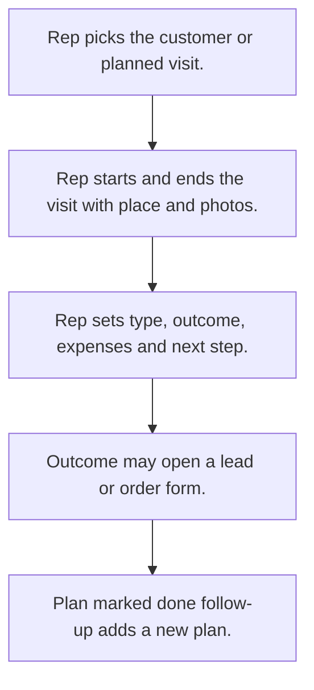

# Field visits

## Usual needs

- Usually has to let a rep log a visit to a customer or lead with place, photos and remarks.
- Usually has to pick visit type and show the right outcome questions.
- Usually has to work out visit time from start and end.
- Usually has to start a new lead or order from the visit outcome.
- Usually has to turn a follow-up date into a new planned visit; mark the plan done when visited.
- Usually has to add the visit place to the location trail.
- Usually has to let managers see team visits and many visit reports.
- Usually has to sometimes remind the rep before a planned visit.
- Usually has to sometimes warn when the rep is too far from the customer place.
- Usually has to sometimes log visit expenses with category and amount.
- Usually has to sometimes send a thank-you message to the contact.

## Process steps

1. Rep picks the customer or planned visit.
2. Rep starts and ends the visit with place and photos.
3. Rep sets type, outcome, expenses and next step.
4. Outcome may open a lead or order form.
5. Plan marked done; follow-up adds a new plan.

## Usual sheets, key fields, roles

- Visit: VisitId, VisitedBy, Date, customer or plan ref, VisitType, outcome fields, Location, photos, expense grid, Feedback, NextFollowUp, FollowupDate
- VisitPlanning: Customer, Priority, AssignedTo, Status {Pending|In Progress|Completed}
- Visit type, priority, territory and expense category lists
- Roles: Sales rep or field executive, Manager, Admin, Owner.

## Neome App / Delivery hint

Neome App: field-visit-management. Delivery: configuration. Hint only; grilling decides.

## Flowchart

## Execute

Only use this to apply this into a Studio Enterprise via MCP.

Placeholders: VisitForm, VisitSheet, VisitPlanForm, VisitPlanSheet, VisitWf. Needs first: customer sheet (TMOD-customer-master), lead sheet (TMOD-lead-management), point sheet (TMOD-location-tracking). If Neome App field-visit-management is installed, `list` and reuse.

1. Roles + vars: `add kind=role` SalesRep, Manager, Admin, Owner; `add kind=var kind=setOfText` VarVisitType, VarPriority, VarPlanStatus {Pending, In Progress, Completed}; `kind=sequence` for VisitId.
2. Lists: `apply PAT-admin-kept-pick-list Execute` (territory, expense category).
3. Plan: VisitPlanForm section (Customer `type=ref`, Priority / Status `type=pickText`, AssignedTo `type=pickUser`, PlanDate `type=date`) → VisitPlanSheet → `spreadsheetLayout kind=table` + `kind=list`.
4. Visit: VisitForm section (VisitId `type=identifier`, VisitedBy `type=userId`, Date, Customer / Plan `type=ref layoutSpreadsheet=<list>`, VisitType `type=pickText`, outcome fields, Location `type=location captureMode=onInsert`, Photos `type=camera`, Start / End `type=dateTime`, Feedback `type=paragraph`, NextFollowUp `type=bool`, FollowupDate `type=date`) + `composite type=grid` Expenses → VisitSheet → table + list.
5. Form logic, apply Execute: PAT-show-field-by-value (outcome by type), PAT-calculated-field (visit time), PAT-copy-fields-from-ref, PAT-line-items-grid-with-totals, PAT-error-field-check (too far), PAT-clock-in-out-with-photo.
6. Outcome: `apply PAT-deeplink-to-form Execute` (open lead or order form).
7. Workflow VisitWf: `eventSsInsertAfter spreadsheet=VisitSheet` → `rowUpdate` plan Completed (`PAT-update-linked-rows`) → `branchIfElse` NextFollowUp → TRUE `rowInsert` new plan (`PAT-insert-row-in-other-sheet`); point row (`PAT-device-location-trail`); thank-you (`PAT-message-on-event`) → `set kind=workflow edgeMap`.
8. Counts + reminders: `PAT-running-total-by-log-field`, `PAT-scheduled-reminder-message`.
9. Actions: `rowInsert` VisitSheet; `apply PAT-role-views-of-one-sheet Execute` → `set kind=group actionPermissionMap`.
10. Reports, apply Execute: PAT-composite-report, PAT-query-report-with-filter, PAT-role-copy-of-report.
11. `validate` till ok=true. `describe` VisitSheet, VisitWf to confirm.

Gaps: edgeMap entry keys unverified (wire 1, describe, mirror). Distance between two points needs formula (verify: describe).
