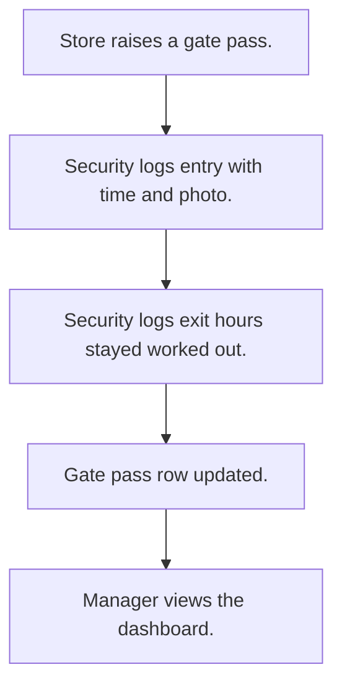

# Gate pass

## Usual needs

- Usually has to raise a gate pass for a driver and vehicle with a pass type.
- Usually has to let security log entry and exit against a pass with photos.
- Usually has to work out hours stayed from entry and exit.
- Usually has to show active passes and today's gate log.
- Usually has to keep pass types and gate staff.

## Process steps

1. Store raises a gate pass.
2. Security logs entry with time and photo.
3. Security logs exit; hours stayed worked out.
4. Gate pass row updated.
5. Manager views the dashboard.

## Usual sheets, key fields, roles

- GatePassType: GatePassType
- GatePass: Date, GatePassId, pass type ref, DriverName, DriverMobile, VehicleNumber, Status
- GateLog: gate pass ref, Entry, EntryImage, EnableExit, Exit, ExitImage, StayedHours
- Roles: Store executive, Security, Operations manager, Admin.

## Neome App / Delivery hint

Neome App: gate-pass-management. Delivery: standard (App gives it out of the box; only Neome App Build evidence so far, no Neome Build). Hint only; grilling decides.

## Flowchart

## Execute

Only use this to apply this into a Studio Enterprise via MCP.

Placeholders: GatePassTypeSheet, GatePassForm, GatePassSheet, GateLogForm, GateLogSheet, GateLogWf. Needs first: none. Delivery standard: if Neome App gate-pass-management is installed, use it; build only when not.

1. Roles + vars: `add kind=role` StoreExecutive, Security, OperationsManager, Admin; `add kind=var kind=setOfText` VarGatePassStatus (values from grilling); `kind=sequence` for GatePassId.
2. Pass types: `apply PAT-admin-kept-pick-list Execute` → GatePassTypeSheet (GatePassType `type=text`).
3. Pass: GatePassForm section (Date `type=date`, GatePassId `type=identifier` per `PAT-generated-id`, DriverName `type=text`, DriverMobile `type=mobileNumber`, VehicleNumber `type=text`, Status `type=pickText`) → GatePassSheet `insertRoles=[StoreExecutive]` → table + list → GatePassType `type=ref`.
4. Log: GateLogForm section (Entry / Exit `type=dateTime`, EntryImage / ExitImage `type=camera`, EnableExit `type=bool`, StayedHours `type=decimal`) → GateLogSheet `insertRoles=[Security] updateRoles=[Security]` → table → GatePass `type=ref`.
5. Form logic, apply Execute: PAT-copy-fields-from-ref (driver, vehicle), PAT-calculated-field (StayedHours), PAT-show-field-by-value (exit fields on EnableExit), PAT-lock-fields-by-visibility, PAT-photo-and-document-capture.
6. Workflow GateLogWf: `eventSsInsertAfter` + `eventSsUpdateAfter spreadsheet=GateLogSheet` → `rowUpdate` pass Status (`apply PAT-update-linked-rows Execute`) → `set kind=workflow edgeMap`.
7. Gate staff: `apply PAT-sheet-row-drives-app-user Execute`.
8. Actions: `rowInsert` + `spreadsheetEditor` per sheet; dashboard (active passes, today's log) `apply PAT-composite-report Execute` → `set kind=group actionPermissionMap`.
9. `validate` till ok=true. `describe` sheets + workflow to confirm.

Gaps: GatePass Status values not in Template (Open Item).
