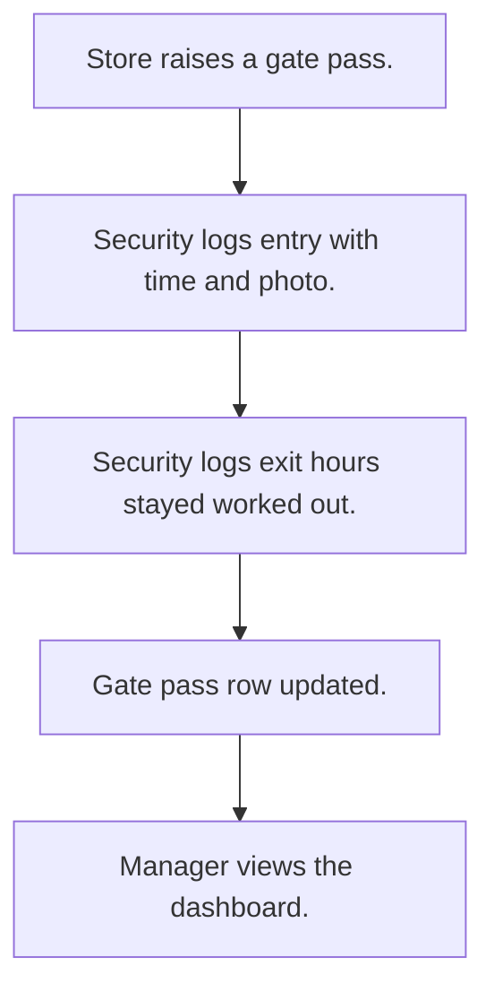

# Gate pass

## Usual needs

- Usually has to raise a gate pass for a driver and vehicle with a pass type.
- Usually has to let security log entry and exit against a pass with photos.
- Usually has to work out hours stayed from entry and exit.
- Usually has to show active passes and today's gate log.
- Usually has to keep pass types and gate staff.

## Process steps

1. Store raises a gate pass.
2. Security logs entry with time and photo.
3. Security logs exit; hours stayed worked out.
4. Gate pass row updated.
5. Manager views the dashboard.

## Usual sheets, key fields, roles

- GatePassType: GatePassType
- GatePass: Date, GatePassId, pass type ref, DriverName, DriverMobile, VehicleNumber, Status
- GateLog: gate pass ref, Entry, EntryImage, EnableExit, Exit, ExitImage, StayedHours
- Roles: Store executive, Security, Operations manager, Admin.

## Neome App / Delivery hint

Neome App: gate-pass-management. Delivery: standard (App gives it out of the box; only Neome App Build evidence so far, no client Build). Hint only; grilling decides.

## Flowchart

