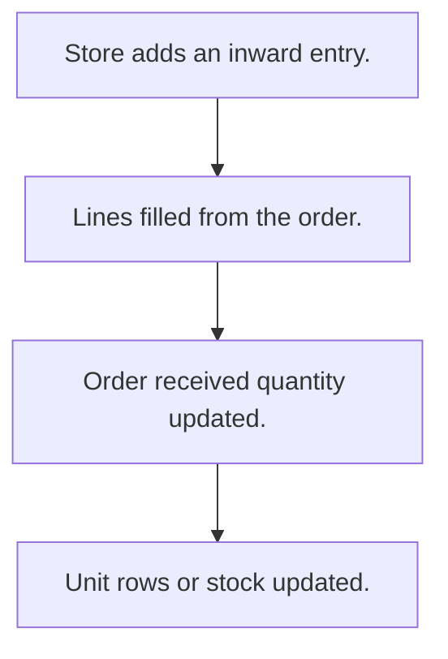

# Goods inward

## Usual needs

- Usually has to record goods received from a vendor, often against a purchase order.
- Usually has to record quantity per material, with weights per lot when needed.
- Usually has to update the order's received quantity.
- Usually has to make one stock row per received unit when units are tracked.
- Usually has to raise stock on receipt.
- Usually has to show delivery time from order to receipt.

## Process steps

1. Store adds an inward entry.
2. Lines filled from the order.
3. Order received quantity updated.
4. Unit rows or stock updated.

## Usual sheets, key fields, roles

- Inward: Date, Vendor or order ref, Warehouse, lines (Material, ReceivedQty), Status
- Roles: Store manager, Accounts.

## Neome App / Delivery hint

Neome App: purchase-management. Delivery: configuration. Hint only; grilling decides.

## Flowchart

