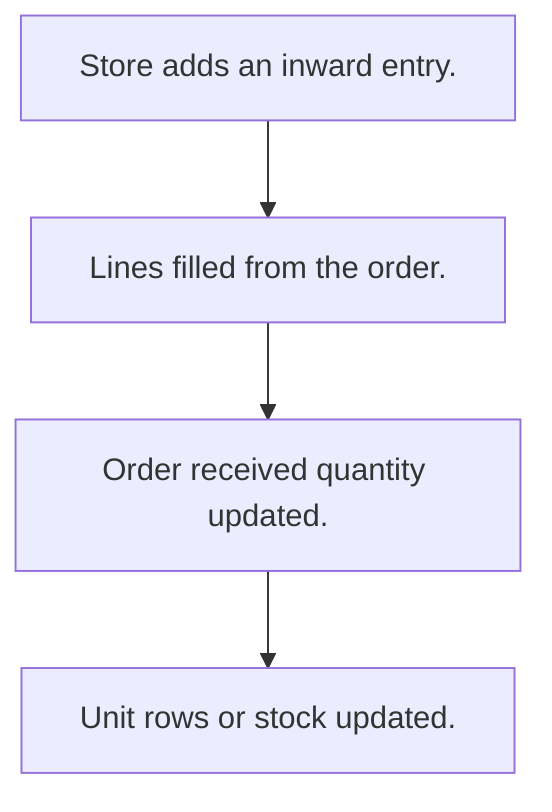

# Goods inward

## Usual needs

- Usually has to record goods received from a vendor, often against a purchase order.
- Usually has to record quantity per material, with weights per lot when needed.
- Usually has to update the order's received quantity.
- Usually has to make one stock row per received unit when units are tracked.
- Usually has to raise stock on receipt.
- Usually has to show delivery time from order to receipt.

## Process steps

1. Store adds an inward entry.
2. Lines filled from the order.
3. Order received quantity updated.
4. Unit rows or stock updated.

## Usual sheets, key fields, roles

- Inward: Date, Vendor or order ref, Warehouse, lines (Material, ReceivedQty), Status
- Roles: Store manager, Accounts.

## Neome App / Delivery hint

Neome App: purchase-management. Delivery: configuration. Hint only; grilling decides.

## Flowchart

## Execute

Only use this to apply this into a Studio Enterprise via MCP.

Placeholders: InwardForm, InwardSheet, InwardWf. Needs first: purchase order sheet (TMOD-purchase-orders), item + stock sheets (TMOD-inventory), vendor + warehouse lists (TMOD-master-data).

1. Roles + vars: `add kind=role` StoreManager, Accounts; `add kind=var kind=setOfText` VarInwardStatus (values from grilling).
2. Form: `add kind=form` InwardForm → `composite type=section` (Date `type=date`, Vendor / Warehouse `type=ref`, Status `type=pickText`) → `composite type=grid` Lines (Material `type=ref`, OrderedQty / ReceivedQty `type=decimal`).
3. Order pick: `apply PAT-pick-from-report-ref Execute` (order + lines) and `PAT-line-items-grid-with-totals`; lot weights shown by `PAT-show-field-by-value`.
4. Sheet: `add kind=spreadsheet` InwardSheet `form=InwardForm insertRoles=[StoreManager]` → `spreadsheetLayout kind=table`.
5. Delivery time: `apply PAT-calculated-field Execute` (`formFormula` receipt date minus order date).
6. Workflow InwardWf: `eventSsInsertAfter spreadsheet=InwardSheet` → `branchIterateGrid grid=Lines` → ITERATE: order received qty (`apply PAT-update-linked-rows Execute`), stock up (`apply PAT-stock-moves-by-workflow Execute`), unit rows `rowInsert` (`PAT-insert-row-in-other-sheet`) when tracked → `set kind=workflow edgeMap`.
7. Actions: `rowInsert` + `spreadsheetEditor` (Accounts `readOnly=true`) → `set kind=group actionPermissionMap`.
8. `validate` till ok=true. `describe` InwardSheet, InwardWf to confirm.

Gaps: one row per unit needs a loop over quantity (verify: describe). edgeMap entry keys unverified.
