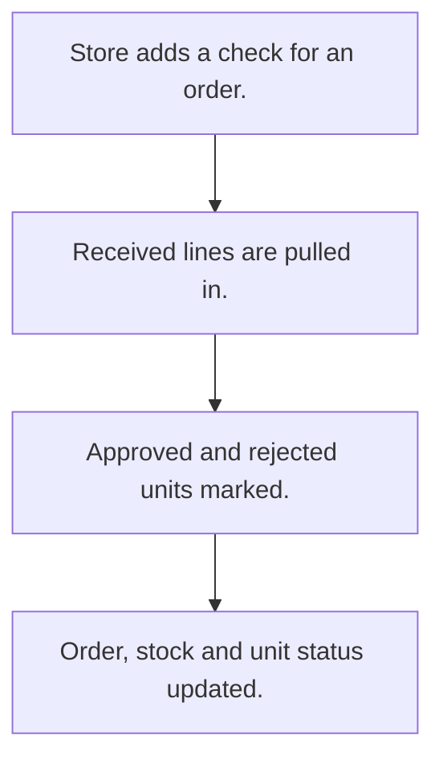

# Incoming quality check

## Usual needs

- Usually has to check received material against a purchase order.
- Usually has to record approved and rejected quantity per material or unit.
- Usually has to attach lab, lab report and photo.
- Usually has to keep rejected share and reason.
- Usually has to block wrong entries.
- Usually has to update order and stock from the result.

## Process steps

1. Store adds a check for an order.
2. Received lines are pulled in.
3. Approved and rejected units marked.
4. Order, stock and unit status updated.

## Usual sheets, key fields, roles

- QualityCheck: Order ref, Lab ref, ReceivedDate, LabDocument, Image, lines (ApprovedQty, RejectedQty, RejectedPercentage, RejectedReason, Error)
- Roles: Store manager.

## Neome App / Delivery hint

Neome App: quality-control. Delivery: configuration. Hint only; grilling decides.

## Flowchart

