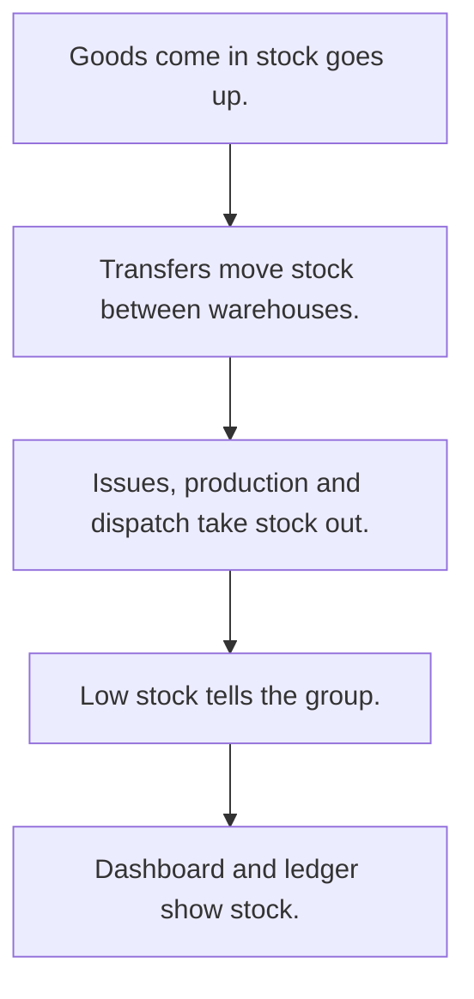

# Inventory and stock

## Usual needs

- Usually has to keep items and materials with unit, min and max levels or reorder and safety stock.
- Usually has to keep stock per item and warehouse, changed by receipts, issues, transfers, production and dispatch.
- Usually has to record goods received into a warehouse, issues out and moves between warehouses.
- Usually has to block a move or issue above stock on hand.
- Usually has to alert when stock is low.
- Usually has to show a stock dashboard, a stock ledger and stock in and out reports.
- Usually has to sometimes upload closing stock in bulk.

## Process steps

1. Goods come in; stock goes up.
2. Transfers move stock between warehouses.
3. Issues, production and dispatch take stock out.
4. Low stock tells the group.
5. Dashboard and ledger show stock.

## Usual sheets, key fields, roles

- Item or material: name, category, unit, Min or ReorderLevel, Max or SafetyStock, price
- Stock per warehouse: Warehouse, Item, AvailableQuantity (log number)
- Receipt (GRN): Warehouse, Vendor, lines, Status {Pending|Received|Cancelled}
- Transfer: Date, From, To, lines, Status {Pending|Transferred|Cancelled}, Error
- Stock out or outward: Date, Warehouse, lines, Status, Error
- Roles: Store or inventory staff, Production, Operations manager, Admin.

## Neome App / Delivery hint

Neome App: inventory-and-stock-management. Delivery: configuration. Hint only; grilling decides.

## Flowchart

## Execute

Only use this to apply this into a Studio Enterprise via MCP.

Placeholders: ItemSheet, StockSheet, ReceiptSheet, TransferSheet, StockOutSheet, StockWf. Needs first: warehouse, vendor, unit, category lists (TMOD-master-data). If Neome App inventory-and-stock-management is installed, `list` and reuse.

1. Roles + vars: `add kind=role` StoreStaff, Production, OperationsManager, Admin; `add kind=var kind=setOfText` VarReceiptStatus {Pending, Received, Cancelled}, VarTransferStatus {Pending, Transferred, Cancelled}, VarStockOutStatus (values from grilling).
2. Item: ItemForm section (Name `type=text`, ReorderLevel / SafetyStock / Price `type=decimal`) → ItemSheet → table + list → Category, Unit `type=ref`.
3. Stock: StockForm section (AvailableQuantity `type=logDecimal`) → StockSheet (`queryables`, `uniqueIndexs` Warehouse+Item `uniquenessMode=combined`) → table + list → Warehouse, Item `type=ref`.
4. Moves: ReceiptForm, TransferForm, StockOutForm: section (Date, Warehouse or From / To `type=ref`, Status `type=pickText`, Error `type=error`) + `composite type=grid` Lines (Item `type=ref`, Qty `type=decimal`) → one sheet each + table.
5. Form logic, apply Execute: PAT-line-items-grid-with-totals, PAT-copy-fields-from-ref, PAT-pick-from-report-ref (stock on hand), PAT-calculated-field, PAT-show-field-by-value, PAT-lock-fields-by-visibility.
6. Stock: `apply PAT-stock-moves-by-workflow Execute` (`eventSsUpdateAfter` → `branchIterateGrid` → `rowUpdateFieldLogNumber operation=add|subtract`) + `PAT-running-total-by-log-field`.
7. Checks, apply Execute: PAT-stop-save-by-workflow-check + PAT-error-field-check (move above stock), PAT-act-on-status-change, PAT-undo-on-cancel (Cancelled puts stock back).
8. Alerts + units: `apply PAT-low-stock-alert Execute` (`sendMessageToGroups`); `PAT-bar-code-per-unit` when units are tracked.
9. Actions: `rowInsert` per move sheet, `spreadsheetEditor` per sheet, `action kind=spreadsheetHistory spreadsheet=StockSheet` (ledger) → `set kind=group actionPermissionMap`.
10. Reports: `PAT-composite-report` (dashboard), `PAT-query-report-with-filter` (stock in / out).
11. `validate` till ok=true. `describe` StockSheet, StockWf to confirm.

Gaps: `uniqueIndexs` value shape (verify: describe). Bulk closing stock upload via `spreadsheetEditor bulkInsertFields` / `bulkUpdateFields` (verify: describe).
