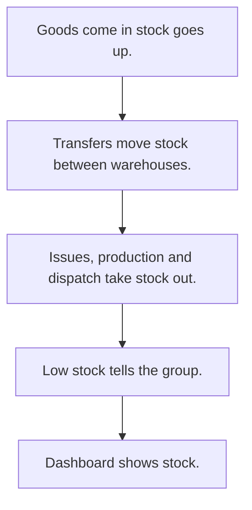

# Inventory and stock

## Usual needs

- Usually has to keep items and materials with unit, min and max levels.
- Usually has to keep stock per item and warehouse, changed by receipts, issues, transfers, production and dispatch.
- Usually has to move stock between warehouses.
- Usually has to book finished goods in and out, never below stock on hand.
- Usually has to alert when stock is low.
- Usually has to show a stock dashboard and stock in and out reports.
- Usually has to sometimes upload closing stock in bulk.

## Process steps

1. Goods come in; stock goes up.
2. Transfers move stock between warehouses.
3. Issues, production and dispatch take stock out.
4. Low stock tells the group.
5. Dashboard shows stock.

## Usual sheets, key fields, roles

- Item or material: name, unit, Min, Max, price
- Stock per warehouse: Warehouse, Item, AvailableQuantity (log number)
- Transfer: Date, From, To, lines, Status {Pending|Transferred|Cancelled}
- Stock in and out: Date, Item, Quantity
- Roles: Store or inventory staff, Production, Operations manager, Admin.

## Neome App / Delivery hint

Neome App: inventory-and-stock-management. Delivery: configuration. Hint only; grilling decides.

## Flowchart

