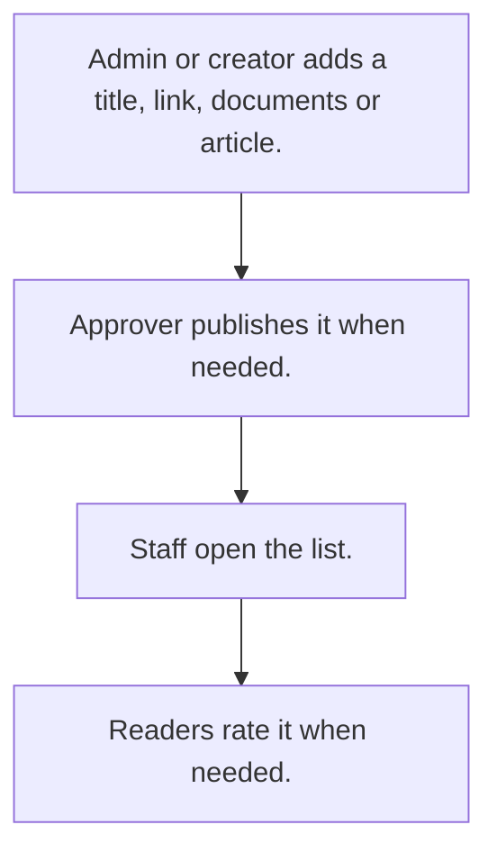

# Knowledge library

## Usual needs

- Usually has to keep titled links, documents or articles for staff, by category.
- Usually has to sometimes approve an article before it is published.
- Usually has to sometimes let readers rate an article and leave feedback.

## Process steps

1. Admin or creator adds a title, link, documents or article.
2. Approver publishes it when needed.
3. Staff open the list.
4. Readers rate it when needed.

## Usual sheets, key fields, roles

- Library item or article: Title, Category, Link or Content, Documents, Version, ApprovalStatus, Status {Draft|Publish}
- Feedback (optional): article ref, Rating, Feedback
- Roles: Admin or content creator, Approver, staff readers.

## Neome App / Delivery hint

Neome App: knowledge-library. Delivery: standard. Hint only; grilling decides.

## Flowchart

