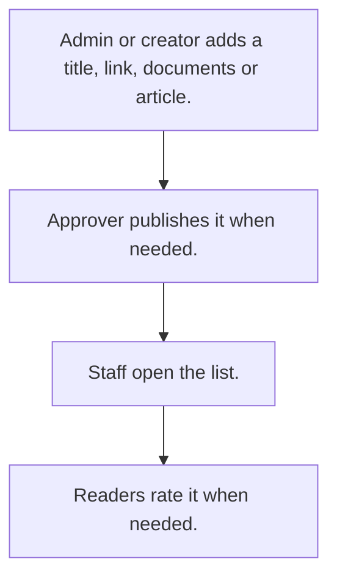

# Knowledge library

## Usual needs

- Usually has to keep titled links, documents or articles for staff, by category.
- Usually has to sometimes approve an article before it is published.
- Usually has to sometimes let readers rate an article and leave feedback.

## Process steps

1. Admin or creator adds a title, link, documents or article.
2. Approver publishes it when needed.
3. Staff open the list.
4. Readers rate it when needed.

## Usual sheets, key fields, roles

- Library item or article: Title, Category, Link or Content, Documents, Version, ApprovalStatus, Status {Draft|Publish}
- Feedback (optional): article ref, Rating, Feedback
- Roles: Admin or content creator, Approver, staff readers.

## Neome App / Delivery hint

Neome App: knowledge-library. Delivery: standard. Hint only; grilling decides.

## Flowchart

## Execute

Only use this to apply this into a Studio Enterprise via MCP.

Placeholders: LibraryItemForm, LibraryItemSheet, CategorySheet, FeedbackSheet. Needs first: none. Delivery standard: if Neome App knowledge-library is installed, use it; build only when not.

1. Roles + vars: `add kind=role` Admin, Approver, Staff; `add kind=var kind=setOfText` VarLibraryStatus {Draft, Publish}, VarApprovalStatus (values from grilling).
2. Category list: `apply PAT-admin-kept-pick-list Execute` → CategorySheet.
3. Form: LibraryItemForm section (Title `type=text`, Link `type=hyperlink`, Content `type=paragraph`, Documents `type=setOfDocument`, Version `type=text`, ApprovalStatus / Status `type=pickText`) → LibraryItemSheet `insertRoles=[Admin] updateRoles=[Admin,Approver]` → table + `kind=list groupByField=Category` → Category `type=ref`.
4. Approval (only when asked): `apply PAT-approval-by-status Execute`.
5. Readers: `apply PAT-role-views-of-one-sheet Execute` (Staff `spreadsheetEditor readOnly=true filterCondition` Status = Publish).
6. Feedback (optional): FeedbackForm section (Rating `type=rating`, Feedback `type=paragraph`) → FeedbackSheet → Article `type=ref`; `PAT-copy-fields-from-ref`; counts on item `PAT-running-total-by-log-field`.
7. Actions: `rowInsert` + `spreadsheetEditor` per sheet → `set kind=group actionPermissionMap`.
8. `validate` till ok=true. `describe` LibraryItemSheet to confirm.

Gaps: `filterCondition.cond` = `var kind=condition`, `value.node` shape (verify: describe).
