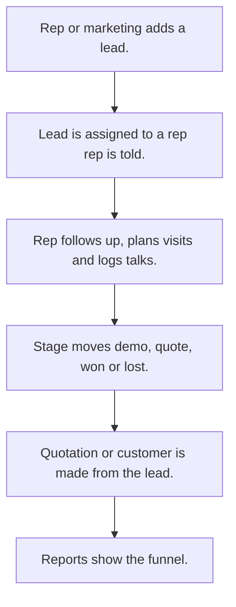

# Lead management

## Usual needs

- Usually has to add a lead with source, contact, place, category and type.
- Usually has to start a lead from a visit or an existing customer.
- Usually has to assign the lead to a rep, by hand or by zone, and tell the rep.
- Usually has to track lead status or stage and a follow-up date.
- Usually has to log follow-ups and visits; count activities or days since the last visit.
- Usually has to remind about follow-ups and chase inactive leads daily.
- Usually has to list the products and quantity the lead wants.
- Usually has to plan a visit for the lead.
- Usually has to hand lead data to a quotation.
- Usually has to show lead counts, funnel, source, rep performance and revenue reports.
- Usually has to sometimes score a lead from source, status and activity count.
- Usually has to sometimes turn a won lead into a customer, contact and opportunity.
- Usually has to sometimes make a lead from an uploaded document or a chat message.

## Process steps

1. Rep or marketing adds a lead.
2. Lead is assigned to a rep; rep is told.
3. Rep follows up, plans visits and logs talks.
4. Stage moves demo, quote, won or lost.
5. Quotation or customer is made from the lead.
6. Reports show the funnel.

## Usual sheets, key fields, roles

- Lead: LeadId, Date, Source, contact, place, Category, AssignTo, Status or Stage, FollowUpDate, products grid, follow-up grid, activity count (log number)
- Activity or follow-up: Lead ref, ActivityType, Discussion, FollowUpDateTime
- Source, activity type and stage lists; scoring rules (optional)
- Stage to probability list (optional)
- Roles: Sales rep, Marketing, Manager, Owner or Admin.

## Neome App / Delivery hint

Neome App: lead-management (crm when accounts and opportunities are needed). Delivery: configuration. Hint only; grilling decides.

## Flowchart

