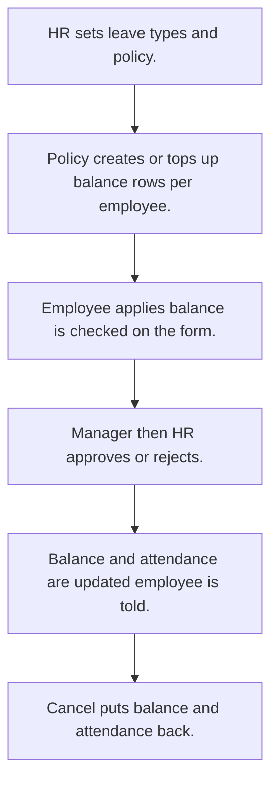

# Leave

## Usual needs

- Usually has to keep leave types and a yearly leave policy (entitlement, carry forward).
- Usually has to keep a balance per employee and leave type.
- Usually has to let an employee apply for full or half day leave and see the balance while applying.
- Usually has to work out leave days without holidays and weekends.
- Usually has to let a manager (and sometimes HR after) approve or reject.
- Usually has to update the balance and the attendance row on approval, and tell the employee.
- Usually has to let the employee cancel and put balance and attendance back.
- Usually has to credit leave monthly and carry forward yearly on a schedule.
- Usually has to sometimes handle comp-off and work-from-home requests.

## Process steps

1. HR sets leave types and policy.
2. Policy creates or tops up balance rows per employee.
3. Employee applies; balance is checked on the form.
4. Manager (then HR) approves or rejects.
5. Balance and attendance are updated; employee is told.
6. Cancel puts balance and attendance back.

## Usual sheets, key fields, roles

- LeaveType: LeaveType
- LeavePolicy: year or dates, LeaveType, AnnualEntitlement, CarryForward {Yes|No}
- Leave register: Employee, LeaveType, AvailableBalance (log number)
- LeaveRequest: Duration {Half Day|Full Day}, FromDate, ToDate, TotalLeaveDays, Reason, ApprovalStatus {Pending|Approved|Rejected}
- Roles: Employee, Manager, HR, Admin.

## Neome App / Delivery hint

Neome App: attendance-and-leave. Delivery: configuration (status approval, log balances, schedules). Hint only; grilling decides.

## Flowchart

## Execute

Only use this to apply this into a Studio Enterprise via MCP.

Placeholders: LeaveTypeSheet, LeavePolicySheet, LeaveRegisterSheet, LeaveRequestForm, LeaveRequestSheet, LeaveWf. Needs first: TMOD-employee-master (employee, manager), TMOD-attendance (attendance row). If Neome App attendance-and-leave is installed, `list` and reuse.

1. Roles + vars: `add kind=role` Employee, Manager, HR, Admin; `add kind=var kind=setOfText` VarLeaveDuration {Half Day, Full Day}, VarApprovalStatus {Pending, Approved, Rejected}, VarYesNo {Yes, No}; `kind=setOfDate` holidays.
2. Leave types: `apply PAT-admin-kept-pick-list Execute` → LeaveTypeSheet.
3. Policy: LeavePolicyForm section (Period `type=dateRange`, AnnualEntitlement `type=decimal`, CarryForward `type=pickText source=VarYesNo`) → LeavePolicySheet → LeaveType `type=ref`.
4. Register: LeaveRegisterForm section (Employee `type=pickUser`, AvailableBalance `type=logDecimal`) → LeaveRegisterSheet (`queryables` Employee, LeaveType) → table + list → LeaveType `type=ref`.
5. Request: LeaveRequestForm section (Employee `type=userId`, Duration `type=pickText`, FromDate / ToDate `type=date`, TotalLeaveDays / Balance `type=decimal`, Reason `type=paragraph`, ApprovalStatus `type=pickText`, Error `type=error`) → LeaveRequestSheet → LeaveType `type=ref`.
6. Form logic, apply Execute: PAT-calculated-field (days without holidays, weekends), PAT-error-field-check (over balance).
7. Balance rows: `apply PAT-fan-out-rows-from-report Execute` (policy → one register row per employee per leave type).
8. Approval: `apply PAT-approval-by-status Execute` + `PAT-multi-level-approval` (Manager, then HR); `PAT-role-views-of-one-sheet`.
9. Workflow LeaveWf: `eventSsUpdateAfter spreadsheet=LeaveRequestSheet` → `branchIfElse` Approved → TRUE `rowUpdateFieldLogNumber operation=subtract` + attendance `rowUpdate` (`PAT-update-linked-rows`) + `sendMessageToUsers` (`PAT-message-on-event`); cancel `apply PAT-undo-on-cancel Execute` (`operation=add`) → `set kind=workflow edgeMap`.
10. Schedules: `apply PAT-scheduled-job-over-rows Execute` (`eventSchedule repeatFrequencyKind=months` credit; `years` carry forward).
11. Actions: `rowInsert` LeaveRequestSheet + `spreadsheetEditor` per sheet / role → `set kind=group actionPermissionMap`.
12. `validate` till ok=true. `describe` LeaveRequestSheet, LeaveWf to confirm.

Gaps: balance shown on form (ref `copyFieldMap` or report) shape (verify: describe). Working-day formula with holidays var unverified. Comp-off, work-from-home not built here (Open Item when asked).
