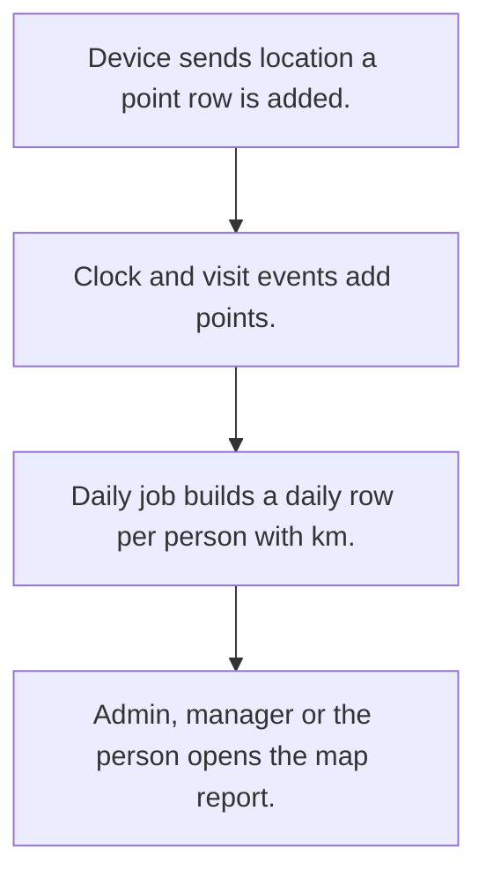

# Field staff location tracking

## Usual needs

- Usually has to store device location points for each field user.
- Usually has to show admin, HR and managers where staff are today and the day's timeline.
- Usually has to show each person their own trail and km.
- Usually has to roll yesterday's points into a daily row with distance.
- Usually has to run daily jobs and evening reminders on a schedule.

## Process steps

1. Device sends location; a point row is added.
2. Clock and visit events add points.
3. Daily job builds a daily row per person with km.
4. Admin, manager or the person opens the map report.

## Usual sheets, key fields, roles

- WatchLocation: user, GeoPoint, DateTime, Source {In|Visit|Live Location|Out}, colour
- DailyLocation: Employee, Date, points, Address, TotalKm
- Roles: Admin, HR, Manager, Support, Employee.

## Neome App / Delivery hint

Neome App: field-visit-management (closest). Delivery: configuration. Hint only; grilling decides.

## Flowchart

