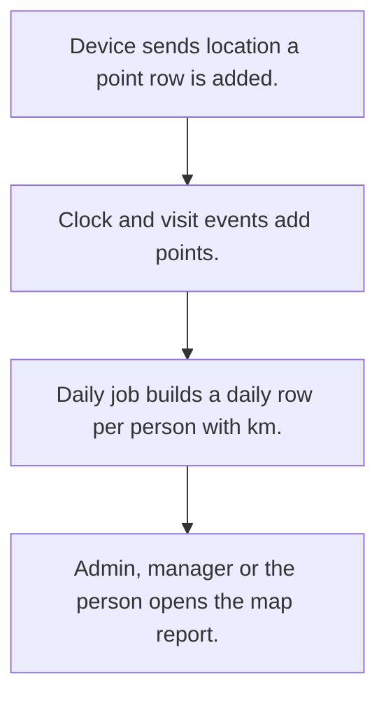

# Field staff location tracking

## Usual needs

- Usually has to store device location points for each field user.
- Usually has to show admin, HR and managers where staff are today and the day's timeline.
- Usually has to show each person their own trail and km.
- Usually has to roll yesterday's points into a daily row with distance.
- Usually has to run daily jobs and evening reminders on a schedule.

## Process steps

1. Device sends location; a point row is added.
2. Clock and visit events add points.
3. Daily job builds a daily row per person with km.
4. Admin, manager or the person opens the map report.

## Usual sheets, key fields, roles

- WatchLocation: user, GeoPoint, DateTime, Source {In|Visit|Live Location|Out}, colour
- DailyLocation: Employee, Date, points, Address, TotalKm
- Roles: Admin, HR, Manager, Support, Employee.

## Neome App / Delivery hint

Neome App: field-visit-management (closest). Delivery: configuration. Hint only; grilling decides.

## Flowchart

## Execute

Only use this to apply this into a Studio Enterprise via MCP.

Placeholders: WatchLocationForm, WatchLocationSheet, DailyLocationSheet, LocationWf. Needs first: TMOD-employee-master (employee, manager).

1. Roles + vars: `add kind=role` Admin, HR, Manager, Support, Employee; `add kind=var kind=setOfText` VarPointSource {In, Visit, Live Location, Out}.
2. Points: WatchLocationForm section (User `type=userId`, GeoPoint `type=geoPoint`, DateTime `type=dateTime`, Source `type=pickText`, Colour `type=color`) → WatchLocationSheet (`queryables` User, DateTime) → table + `kind=map locationField=GeoPoint`.
3. Daily: DailyLocationForm section (Employee `type=pickUser`, Date `type=date`, Address `type=text`, TotalKm `type=decimal`) + `composite type=grid` Points → DailyLocationSheet → table.
4. Device + clock / visit points: `apply PAT-device-location-trail Execute` (`eventUserLocation locationCapture{type=scheduled, roles, fromTime, toTime, frequencyBasedOnTime}` → `rowInsert`).
5. Daily job + reminders: `apply PAT-scheduled-job-over-rows Execute` (`eventSchedule` daily → `branchIterateSpreadsheet` → `rowInsert` daily row with km); `PAT-scheduled-reminder-message` (evening) → `set kind=workflow edgeMap`.
6. Reports: `PAT-query-report-with-filter` (today's map, timeline, own trail), `PAT-composite-report`, `PAT-role-copy-of-report` (team, own) → `action kind=report` → `set kind=group actionPermissionMap`.
7. `validate` till ok=true. `describe` WatchLocationSheet, LocationWf to confirm.

Gaps: km from points needs `executeJavascript` or formula (verify: describe). `eventUserLocation` output params unverified.
