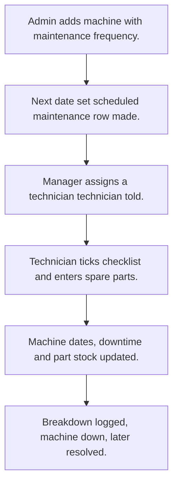

# Machine and tool maintenance

## Usual needs

- Usually has to keep a machine register with category, location and install date.
- Usually has to plan preventive maintenance by frequency and remind before it is due.
- Usually has to let a technician do maintenance with a checklist and spare parts used.
- Usually has to log breakdowns and add downtime to the machine.
- Usually has to keep spare part stock and warn at reorder level.
- Usually has to show machines, breakdowns and maintenance cost for a date range.

## Process steps

1. Admin adds machine with maintenance frequency.
2. Next date set; scheduled maintenance row made.
3. Manager assigns a technician; technician told.
4. Technician ticks checklist and enters spare parts.
5. Machine dates, downtime and part stock updated.
6. Breakdown logged, machine down, later resolved.

## Usual sheets, key fields, roles

- Machine: MachineCode, Category, Location, InstallationDate, MaintenanceFrequency, NextMaintenanceDate, RemainderDate, Status, TotalBreakdownHr
- Maintenance: Machine ref, MaintenanceType, AssignedTo, Cost, DowntimeHours, Status, spare parts grid, checklist grid
- Breakdown: Machine ref, ReportedOn, Status, ResolvedBy, ResolvedOn, DowntimeHours, RootCauseAnalysis
- SparePart: PartName, AvailableQuantity (log number), ReorderQuantity
- Roles: Maintenance technician, Maintenance manager, Admin.

## Neome App / Delivery hint

Neome App: machine-tools-maintenance. Delivery: standard (App gives it out of the box; only Neome App Build evidence so far, no client Build). Hint only; grilling decides.

## Flowchart

