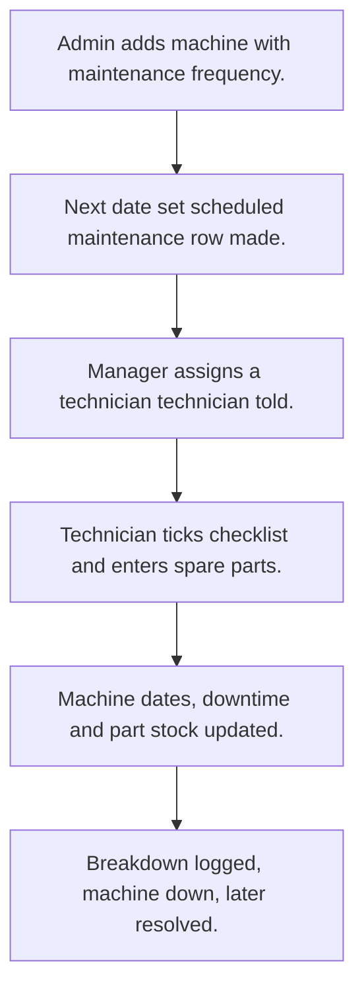

# Machine and tool maintenance

## Usual needs

- Usually has to keep a machine register with category, location and install date.
- Usually has to plan preventive maintenance by frequency and remind before it is due.
- Usually has to let a technician do maintenance with a checklist and spare parts used.
- Usually has to log breakdowns and add downtime to the machine.
- Usually has to keep spare part stock and warn at reorder level.
- Usually has to show machines, breakdowns and maintenance cost for a date range.

## Process steps

1. Admin adds machine with maintenance frequency.
2. Next date set; scheduled maintenance row made.
3. Manager assigns a technician; technician told.
4. Technician ticks checklist and enters spare parts.
5. Machine dates, downtime and part stock updated.
6. Breakdown logged, machine down, later resolved.

## Usual sheets, key fields, roles

- Machine: MachineCode, Category, Location, InstallationDate, MaintenanceFrequency, NextMaintenanceDate, RemainderDate, Status, TotalBreakdownHr
- Maintenance: Machine ref, MaintenanceType, AssignedTo, Cost, DowntimeHours, Status, spare parts grid, checklist grid
- Breakdown: Machine ref, ReportedOn, Status, ResolvedBy, ResolvedOn, DowntimeHours, RootCauseAnalysis
- SparePart: PartName, AvailableQuantity (log number), ReorderQuantity
- Roles: Maintenance technician, Maintenance manager, Admin.

## Neome App / Delivery hint

Neome App: machine-tools-maintenance. Delivery: standard (App gives it out of the box; only Neome App Build evidence so far, no Neome Build). Hint only; grilling decides.

## Flowchart

## Execute

Only use this to apply this into a Studio Enterprise via MCP.

Placeholders: MachineSheet, MaintenanceSheet, BreakdownSheet, SparePartSheet, MaintenanceWf. Needs first: none. Delivery standard: if Neome App machine-tools-maintenance is installed, use it; build only when not.

1. Roles + vars: `add kind=role` MaintenanceTechnician, MaintenanceManager, Admin; `add kind=var kind=setOfText` VarMachineStatus, VarMaintenanceStatus, VarBreakdownStatus, VarMaintenanceType (values from grilling).
2. Lists: CategorySheet, LocationSheet (one `type=text` field each) → table + list.
3. Machine: MachineForm section (MachineCode `type=text`, InstallationDate / NextMaintenanceDate / RemainderDate `type=date`, MaintenanceFrequency `type=duration`, Status `type=pickText`, TotalBreakdownHr `type=logDecimal`) → MachineSheet → table + list → Category, Location `type=ref`.
4. Parts: SparePartForm section (PartName `type=text`, AvailableQuantity `type=logDecimal`, ReorderQuantity `type=decimal`) → SparePartSheet → table + list.
5. Maintenance: MaintenanceForm section (MaintenanceType / Status `type=pickText`, AssignedTo `type=pickUser`, Cost / DowntimeHours `type=decimal`) + `composite type=grid` SpareParts, Checklist (Done `type=bool`) → MaintenanceSheet → Machine, Part `type=ref`.
6. Breakdown: BreakdownForm section (ReportedOn / ResolvedOn `type=dateTime`, Status `type=pickText`, ResolvedBy `type=pickUser`, DowntimeHours `type=decimal`, RootCauseAnalysis `type=paragraph`) → BreakdownSheet → Machine `type=ref`.
7. Form logic, apply Execute: PAT-calculated-field (next date, downtime), PAT-copy-fields-from-ref, PAT-pick-from-report-ref (parts on hand), PAT-show-field-by-value, PAT-lock-fields-by-visibility.
8. Plan: `apply PAT-per-row-scheduler Execute` (`executeScheduler` per machine → `rowInsert` MaintenanceSheet per `PAT-insert-row-in-other-sheet`).
9. Workflows, apply Execute: PAT-message-on-event (tell technician), PAT-update-linked-rows (machine dates), PAT-running-total-by-log-field (`rowUpdateFieldLogNumber operation=subtract` parts; `add` downtime), PAT-low-stock-alert, PAT-act-on-status-change (breakdown down / resolved), PAT-shared-sub-workflow → `set kind=workflow edgeMap`.
10. Users + menu: `PAT-sheet-row-drives-app-user` (technicians), `PAT-menu-by-button-form`.
11. Actions + reports: `rowInsert` + `spreadsheetEditor` per sheet; `PAT-composite-report`, `PAT-query-report-with-filter` (cost, breakdowns by date) → `set kind=group actionPermissionMap`.
12. `validate` till ok=true. `describe` MachineSheet, MaintenanceWf to confirm.

Gaps: status and type values not in Template (Open Item). edgeMap entry keys unverified.
