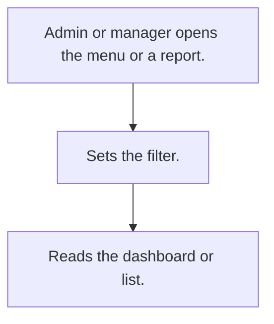

# Management reports

## Usual needs

- Usually has to give admin and owner dashboards and reports by date, zone, team and user.
- Usually has to give managers the same reports for their team.
- Usually has to open many reports from one menu.
- Usually has to show planning figures such as how much to produce.

## Process steps

1. Admin or manager opens the menu or a report.
2. Sets the filter.
3. Reads the dashboard or list.

## Usual sheets, key fields, roles

- No own sheets; filter and output forms only.
- Roles: Admin, Owner, HR, Manager.

## Neome App / Delivery hint

Neome App: none. Delivery: configuration (reports). Hint only; grilling decides.

## Flowchart

