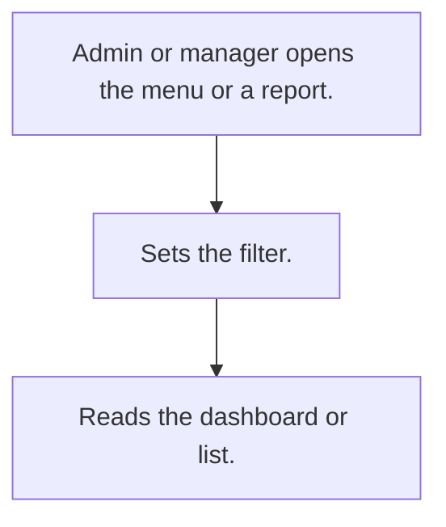

# Management reports

## Usual needs

- Usually has to give admin and owner dashboards and reports by date, zone, team and user.
- Usually has to give managers the same reports for their team.
- Usually has to open many reports from one menu.
- Usually has to show planning figures such as how much to produce.

## Process steps

1. Admin or manager opens the menu or a report.
2. Sets the filter.
3. Reads the dashboard or list.

## Usual sheets, key fields, roles

- No own sheets; filter and output forms only.
- Roles: Admin, Owner, HR, Manager.

## Neome App / Delivery hint

Neome App: none. Delivery: configuration (reports). Hint only; grilling decides.

## Flowchart

## Execute

Only use this to apply this into a Studio Enterprise via MCP.

Placeholders: <Report>FilterForm, <Report>OutForm, <Report>Report, ReportsMenu. Needs first: the source modules' sheets (no own sheets here).

1. Roles: reuse Admin, Owner, HR, Manager (`list kind=role`; `add kind=role` only if missing).
2. Each report: `apply PAT-query-report-with-filter Execute` (filter `inputForm` with date range, zone, team, user → output form + `composite type=grid` → `gridLayout kind=table` → `formLayout type=content rootLayout=true` → `report kind=query` or `kind=spreadsheet` → `action kind=report`).
3. Dashboards: `apply PAT-composite-report Execute` (`report kind=composite mergeReports=[…]`).
4. Manager copy: `apply PAT-role-copy-of-report Execute` (same report, team filter).
5. Menu: `apply PAT-menu-by-button-form Execute` (button `targetType=callReport`) or `action kind=actionsSet actions=[…]`.
6. Group: `set kind=group actionPermissionMap` (each report action, roles).
7. `validate` till ok=true. `describe` each report to confirm.

Gaps: planning figures (how much to produce) need source sheets named by grilling (Open Item).
