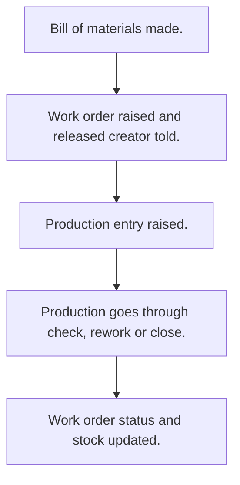

# Manufacturing

## Usual needs

- Usually has to keep product, raw material, unit and work centre lists.
- Usually has to define a bill of materials per product.
- Usually has to plan work orders against a bill of materials, work centre and sometimes a warehouse.
- Usually has to record production against a work order and use up raw material.
- Usually has to check raw material is enough before production.
- Usually has to make work order status follow production.
- Usually has to sometimes show delay against the plan.
- Usually has to show a manufacturing dashboard by date range.

## Process steps

1. Bill of materials made.
2. Work order raised and released; creator told.
3. Production entry raised.
4. Production goes through check, rework or close.
5. Work order status and stock updated.

## Usual sheets, key fields, roles

- BOM: Product, Version, IsActive, raw material lines with RequiredQty
- WorkOrder: Warehouse, BOM, WorkCenter, PlannedQty, dates, Status
- Production: WorkCenter, WorkOrder, Status, material lines (Required, Available, Consumed), Delay
- WorkCenter: WorkCenter, Capacity
- Roles: Production executive, Quality inspector, Operations manager, Admin.

## Neome App / Delivery hint

Neome App: manufacturing. Delivery: configuration. Hint only; grilling decides.

## Flowchart

