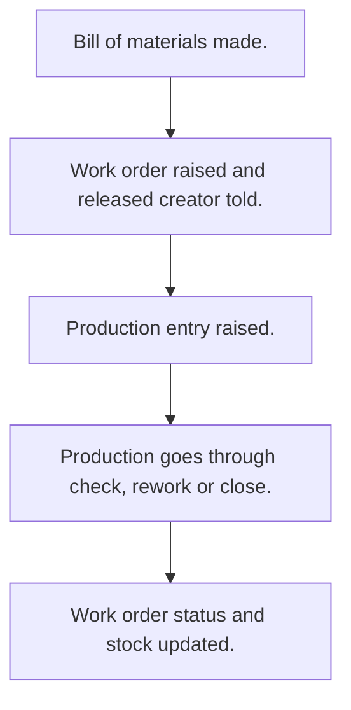

# Manufacturing

## Usual needs

- Usually has to keep product, raw material, unit and work centre lists.
- Usually has to define a bill of materials per product.
- Usually has to plan work orders against a bill of materials, work centre and sometimes a warehouse.
- Usually has to record production against a work order and use up raw material.
- Usually has to check raw material is enough before production.
- Usually has to make work order status follow production.
- Usually has to sometimes show delay against the plan.
- Usually has to show a manufacturing dashboard by date range.

## Process steps

1. Bill of materials made.
2. Work order raised and released; creator told.
3. Production entry raised.
4. Production goes through check, rework or close.
5. Work order status and stock updated.

## Usual sheets, key fields, roles

- BOM: Product, Version, IsActive, raw material lines with RequiredQty
- WorkOrder: Warehouse, BOM, WorkCenter, PlannedQty, dates, Status
- Production: WorkCenter, WorkOrder, Status, material lines (Required, Available, Consumed), Delay
- WorkCenter: WorkCenter, Capacity
- Roles: Production executive, Quality inspector, Operations manager, Admin.

## Neome App / Delivery hint

Neome App: manufacturing. Delivery: configuration. Hint only; grilling decides.

## Flowchart

## Execute

Only use this to apply this into a Studio Enterprise via MCP.

Placeholders: WorkCenterSheet, BomSheet, WorkOrderSheet, ProductionSheet, ProductionWf. Needs first: item, stock, warehouse sheets (TMOD-inventory), unit list (TMOD-master-data). If Neome App manufacturing is installed, `list` and reuse.

1. Roles + vars: `add kind=role` ProductionExecutive, QualityInspector, OperationsManager, Admin; `add kind=var kind=setOfText` VarWorkOrderStatus, VarProductionStatus (check, rework, close; values from grilling).
2. Work centres: `apply PAT-admin-kept-pick-list Execute` → WorkCenterSheet (WorkCenter `type=text`, Capacity `type=decimal`).
3. BOM: BomForm section (Version `type=text`, IsActive `type=bool`) + `composite type=grid` Materials (RequiredQty `type=decimal`) → BomSheet → table + list → Product, RawMaterial `type=ref`.
4. Work order: WorkOrderForm section (PlannedQty `type=decimal`, StartDate / EndDate `type=date`, Status `type=pickText`) → WorkOrderSheet → table + list → Warehouse, Bom, WorkCenter `type=ref`.
5. Production: ProductionForm section (Status `type=pickText`, Delay `type=decimal`, Error `type=error`) + `composite type=grid` Materials (Required / Available / Consumed `type=decimal`) → ProductionSheet → WorkCenter, WorkOrder, Material `type=ref`.
6. Form logic, apply Execute: PAT-copy-fields-from-ref (BOM lines in), PAT-line-items-grid-with-totals, PAT-calculated-field (required qty, delay), PAT-error-field-check (raw material short), PAT-lock-fields-by-visibility.
7. Workflows, apply Execute: PAT-act-on-status-change + PAT-update-linked-rows (production → work order status), PAT-stock-moves-by-workflow (use raw, add finished), PAT-message-on-event (release → tell creator) → `set kind=workflow edgeMap`.
8. Actions: `rowInsert` + `spreadsheetEditor` per sheet → `set kind=group actionPermissionMap`.
9. Reports: `PAT-composite-report` (dashboard by date range), `PAT-query-report-with-filter`.
10. `validate` till ok=true. `describe` ProductionSheet, ProductionWf to confirm.

Gaps: BOM grid into production grid needs `var kind=mapping` `gridMappingMap` (verify: describe).
