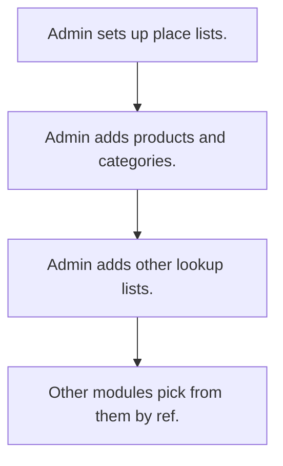

# Master data lists

## Usual needs

- Usually has to keep place lists (country, state, city, zone or area) that link up.
- Usually has to keep product, category, unit and tax lists.
- Usually has to keep business lists: billing entities, vendors, transporters, customer types, expense categories.
- Usually has to let only admin or HR edit lists; others pick from them.
- Usually has to open all lists from one menu.

## Process steps

1. Admin sets up place lists.
2. Admin adds products and categories.
3. Admin adds other lookup lists.
4. Other modules pick from them by ref.

## Usual sheets, key fields, roles

- Country, State, City (or Zone, State, Town, Area): name plus ref to parent
- Product: code, name, category, unit, price, tax
- Short lookup sheets: one text field each
- Roles: Admin, HR, store or sales coordinator for some lists.

## Neome App / Delivery hint

Neome App: none (shared lists under other apps). Delivery: configuration. Hint only; grilling decides.

## Flowchart

## Execute

Only use this to apply this into a Studio Enterprise via MCP.

Placeholders: CountrySheet, StateSheet, CitySheet, ProductSheet, <List>Sheet, MastersMenu. Needs first: none; ProductSheet (TMOD-product-catalog) only if products are asked.

1. Roles: `add kind=role` Admin, HR, Coordinator (only roles asked).
2. Places: `apply PAT-chained-place-lists Execute` (CountrySheet → StateSheet with Country `type=ref` → CitySheet with State `type=ref` + `filterCondition`).
3. Product: don't build a second ProductSheet; TMOD-product-catalog owns it (`apply TMOD-product-catalog Execute` step 2 when products asked). Category, Unit, Tax lists come from step 4; link them on ProductSheet as `type=ref` only if the Enterprise wants refs, not pickText.
4. Short lists: `apply PAT-admin-kept-pick-list Execute` per list (one `type=text` field → sheet → table + list).
5. Rights: each sheet `insertRoles` / `updateRoles` / `removeRoles=[Admin,HR]`; others pick via `type=ref layoutSpreadsheet=<list>`.
6. When asked, apply Execute: PAT-soft-disable-by-status, PAT-copy-fields-from-ref, PAT-customer-price-list, PAT-low-stock-alert.
7. Menu: `action kind=spreadsheetEditor` per sheet → `apply PAT-action-set-menu Execute` (`action kind=actionsSet actions=[…]`) or `PAT-menu-by-button-form` → `set kind=group actionPermissionMap`.
8. `validate` till ok=true. `describe` sheets to confirm.

Gaps: none beyond the applied Patterns.
