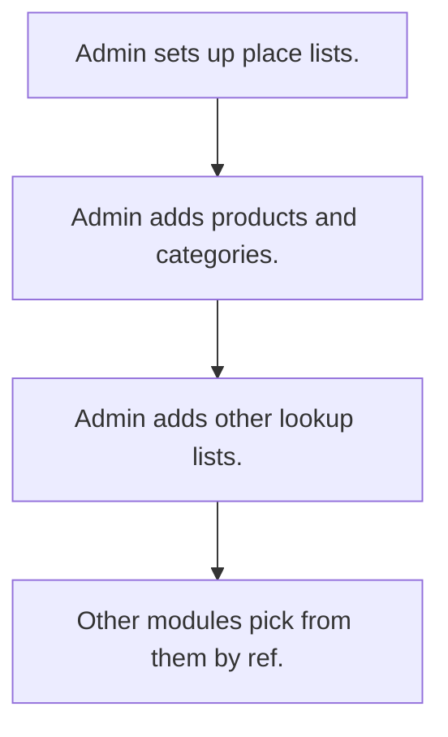

# Master data lists

## Usual needs

- Usually has to keep place lists (country, state, city, zone or area) that link up.
- Usually has to keep product, category, unit and tax lists.
- Usually has to keep business lists: billing entities, vendors, transporters, customer types, expense categories.
- Usually has to let only admin or HR edit lists; others pick from them.
- Usually has to open all lists from one menu.

## Process steps

1. Admin sets up place lists.
2. Admin adds products and categories.
3. Admin adds other lookup lists.
4. Other modules pick from them by ref.

## Usual sheets, key fields, roles

- Country, State, City (or Zone, State, Town, Area): name plus ref to parent
- Product: code, name, category, unit, price, tax
- Short lookup sheets: one text field each
- Roles: Admin, HR, store or sales coordinator for some lists.

## Neome App / Delivery hint

Neome App: none (shared lists under other apps). Delivery: configuration. Hint only; grilling decides.

## Flowchart

