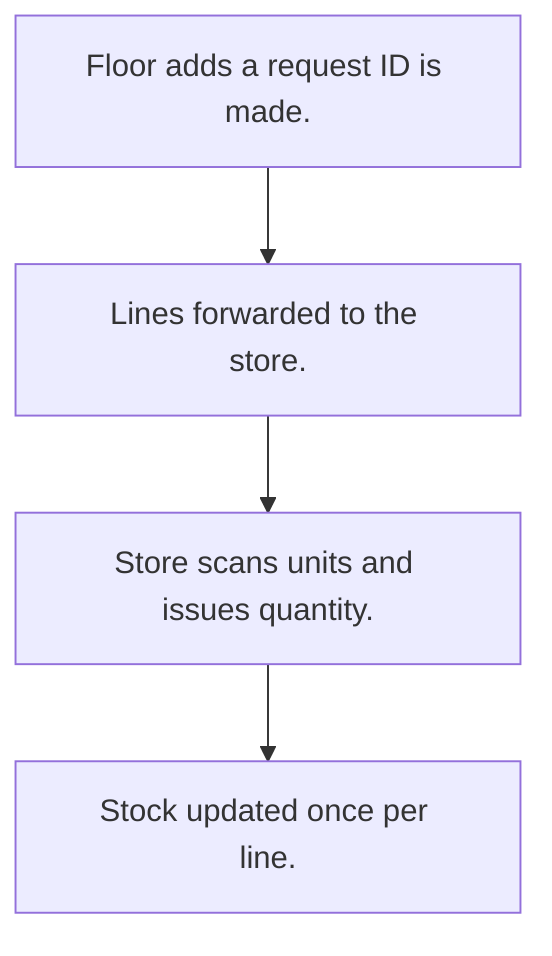

# Material request and issue

## Usual needs

- Usually has to let the floor ask the store for material with quantity and reason.
- Usually has to let the store issue and record issued quantity.
- Usually has to show stock on hand while issuing.
- Usually has to scan or type unit codes to issue.
- Usually has to cut stock once per line.
- Usually has to show who asked and who issued.

## Process steps

1. Floor adds a request; ID is made.
2. Lines forwarded to the store.
3. Store scans units and issues quantity.
4. Stock updated once per line.

## Usual sheets, key fields, roles

- Request: RequestId, Date, RequestedBy, IssuedBy
- Request line: Material, RequestedQuantity, Reason, IssuedQuantity, picked units grid (Code, Quantity, Processed)
- Roles: Floor manager, Store manager.

## Neome App / Delivery hint

Neome App: inventory-and-stock-management. Delivery: configuration. Hint only; grilling decides.

## Flowchart

## Execute

Only use this to apply this into a Studio Enterprise via MCP.

Placeholders: MaterialRequestSheet, RequestLineForm, RequestLineSheet, IssueWf. Needs first: item, stock, unit code sheets (TMOD-inventory).

1. Roles + vars: `add kind=role` FloorManager, StoreManager; `add kind=var kind=sequence` for RequestId.
2. Request: MaterialRequestForm section (RequestId `type=identifier` per `PAT-generated-id`, Date `type=date`, RequestedBy `type=userId`, IssuedBy `type=pickUser`) → MaterialRequestSheet → table + list.
3. Line: RequestLineForm section (RequestedQuantity / IssuedQuantity / StockOnHand `type=decimal`, Reason `type=text`) + `composite type=grid` PickedUnits (Code `type=scanCode`, Quantity `type=decimal`, Processed `type=bool`) → RequestLineSheet → Request, Material `type=ref`.
4. Form logic, apply Execute: PAT-copy-fields-from-ref (stock on hand), PAT-line-items-grid-with-totals (issued = sum of units), PAT-show-field-by-value, PAT-bar-code-per-unit (scan).
5. Forward: `apply PAT-forward-row Execute` (`rowForward toGroups=[…]` to the store).
6. Issue: `apply PAT-button-runs-workflow Execute` → IssueWf `branchIterateGrid grid=PickedUnits` → `branchIfElse` Processed → FALSE `rowUpdateFieldLogNumber operation=subtract` + set Processed (`PAT-stock-moves-by-workflow`) → `set kind=workflow edgeMap`.
7. Actions: `rowInsert` MaterialRequestSheet + `spreadsheetEditor` per role → `set kind=group actionPermissionMap`.
8. `validate` till ok=true. `describe` RequestLineSheet, IssueWf to confirm.

Gaps: button to workflow pairing inferred (verify: describe). edgeMap entry keys unverified.
