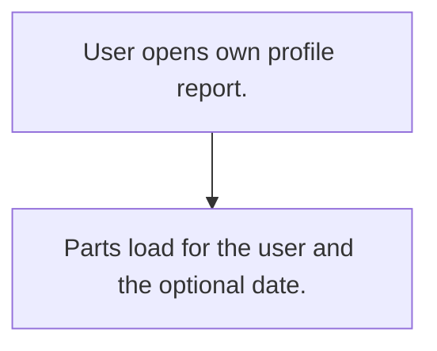

# My profile view

## Usual needs

- Usually has to show each user their own details, balances and items on one screen (leave, holidays, targets, visits, expenses, complaints, transactions).

## Process steps

1. User opens own profile report.
2. Parts load for the user and the optional date.

## Usual sheets, key fields, roles

- No own sheets; reads other modules.
- Roles: Every user role.

## Neome App / Delivery hint

Neome App: none. Delivery: configuration (composite report). Hint only; grilling decides.

## Flowchart

