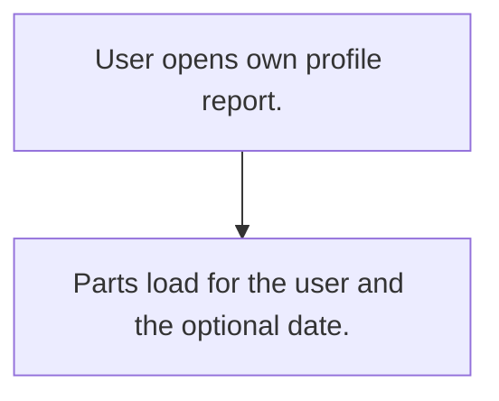

# My profile view

## Usual needs

- Usually has to show each user their own details, balances and items on one screen (leave, holidays, targets, visits, expenses, complaints, transactions).

## Process steps

1. User opens own profile report.
2. Parts load for the user and the optional date.

## Usual sheets, key fields, roles

- No own sheets; reads other modules.
- Roles: Every user role.

## Neome App / Delivery hint

Neome App: none. Delivery: configuration (composite report). Hint only; grilling decides.

## Flowchart

## Execute

Only use this to apply this into a Studio Enterprise via MCP.

Placeholders: ProfileFilterForm, <Part>OutForm, MyProfileReport. Needs first: the source modules' sheets (leave, holidays, targets, visits, expenses, complaints, transactions).

1. Roles: reuse every user role (`list kind=role`).
2. Filter: `add kind=form` ProfileFilterForm → section → Date `type=date` (optional) as report `inputForm`.
3. Parts: per source, output form + section or `composite type=grid` → `gridLayout kind=table` → `report kind=spreadsheet` or `kind=query` with `filterCondition` on the caller (`var kind=condition`).
4. Join: `apply PAT-composite-report Execute` (`report kind=composite mergeReports=[…]`, `formLayout type=content rootLayout=true`).
5. Action: `add kind=action kind=report report=MyProfileReport outputFormContentLayout=<root layout>` → `set kind=group actionPermissionMap` (all roles).
6. `validate` till ok=true. `describe` MyProfileReport to confirm.

Gaps: "own user" filter via context caller binder (verify: describe).
