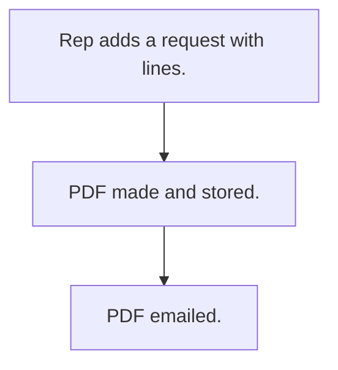

# New product request

## Usual needs

- Usually has to let a rep ask for a new product for a customer or lead.
- Usually has to list categories, expected quantity, photos and remarks.
- Usually has to send the request as a PDF by email.

## Process steps

1. Rep adds a request with lines.
2. PDF made and stored.
3. PDF emailed.

## Usual sheets, key fields, roles

- Request: Date, EnteredBy, target, NoOfSamples, lines (Category, ExpectedOrderQty, photos, Remarks)
- Roles: Sales rep, Manager, Admin.

## Neome App / Delivery hint

Neome App: product-lifecycle-management (closest). Delivery: configuration. Hint only; grilling decides.

## Flowchart

