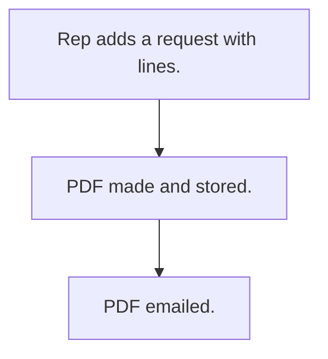

# New product request

## Usual needs

- Usually has to let a rep ask for a new product for a customer or lead.
- Usually has to list categories, expected quantity, photos and remarks.
- Usually has to send the request as a PDF by email.

## Process steps

1. Rep adds a request with lines.
2. PDF made and stored.
3. PDF emailed.

## Usual sheets, key fields, roles

- Request: Date, EnteredBy, target, NoOfSamples, lines (Category, ExpectedOrderQty, photos, Remarks)
- Roles: Sales rep, Manager, Admin.

## Neome App / Delivery hint

Neome App: product-lifecycle-management (closest). Delivery: configuration. Hint only; grilling decides.

## Flowchart

## Execute

Only use this to apply this into a Studio Enterprise via MCP.

Placeholders: NewProductRequestForm, NewProductRequestSheet, RequestPdfWf. Needs first: customer + lead sheets (TMOD-customer-master, TMOD-lead-management), category list.

1. Roles: `add kind=role` SalesRep, Manager, Admin.
2. Form: NewProductRequestForm section (Date `type=date`, EnteredBy `type=userId`, NoOfSamples `type=number`, Pdf `type=document`) + `composite type=grid` Lines (ExpectedOrderQty `type=decimal`, Photos `type=camera`, Remarks `type=paragraph`) → NewProductRequestSheet → table → Lines.Category `type=ref`.
3. Target + media, apply Execute: PAT-lead-or-customer-pick, PAT-photo-and-document-capture.
4. PDF: `apply PAT-pdf-from-report Execute` (content `formLayout` → `eventSsInsertAfter` → `generatePdf contentLayout=… outputField=Pdf` → `rowUpdate`).
5. Email: `sendEmail subject message toUsers attachmentField=Pdf` after `generatePdf` → `set kind=workflow edgeMap`.
6. Actions: `rowInsert` + `spreadsheetEditor` → `set kind=group actionPermissionMap`.
7. `validate` till ok=true. `describe` sheet + RequestPdfWf to confirm.

Gaps: email recipients not in Template (Open Item).
