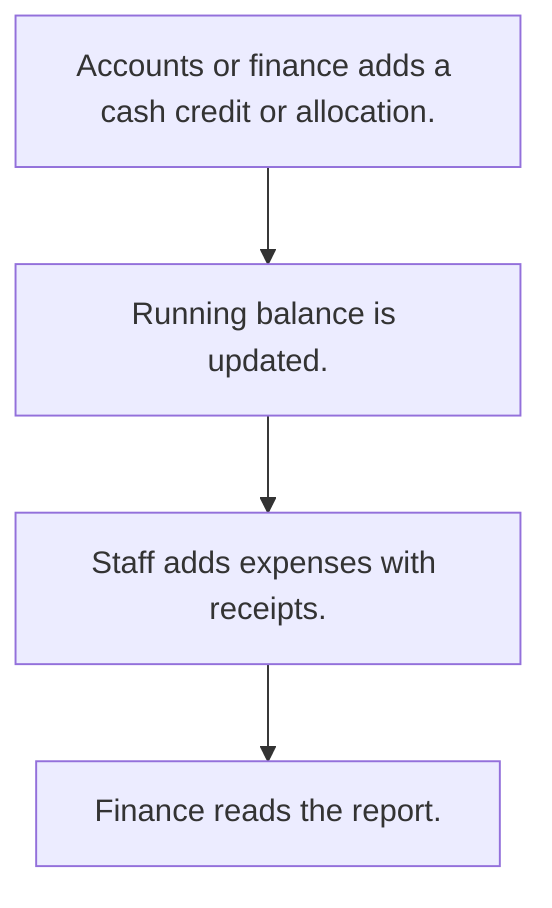

# Office petty cash

## Usual needs

- Usually has to record cash given to a person or received into the office.
- Usually has to let staff log small office expenses with category, mode and receipt photo.
- Usually has to keep a running cash balance per person.
- Usually has to show credits and expenses together for a date range.

## Process steps

1. Accounts or finance adds a cash credit or allocation.
2. Running balance is updated.
3. Staff adds expenses with receipts.
4. Finance reads the report.

## Usual sheets, key fields, roles

- Cash credit or allocation: Date, person, Amount, Remarks
- Office expense: Date, Category, Amount, Status, PaymentMode, receipt image
- Roles: Accounts or finance, office staff, Owner.

## Neome App / Delivery hint

Neome App: expense-management. Delivery: configuration. Hint only; grilling decides.

## Flowchart

## Execute

Only use this to apply this into a Studio Enterprise via MCP.

Placeholders: CashCreditSheet, OfficeExpenseSheet, CashBalanceSheet, PettyCashWf. Needs first: expense category list (TMOD-master-data). If Neome App expense-management is installed, `list` and reuse.

1. Roles + vars: `add kind=role` Accounts, OfficeStaff, Owner; `add kind=var kind=setOfText` VarExpenseStatus, VarPaymentMode (values from grilling).
2. Credit: CashCreditForm section (Date `type=date`, Person `type=pickUser`, Amount `type=decimal`, Remarks `type=paragraph`) → CashCreditSheet `insertRoles=[Accounts]` → table.
3. Expense: OfficeExpenseForm section (Date, Amount `type=decimal`, Status / PaymentMode `type=pickText`, Receipt `type=camera`) → OfficeExpenseSheet → table → Category `type=ref`.
4. Form logic, apply Execute: PAT-show-field-by-value, PAT-calculated-field, PAT-photo-and-document-capture.
5. Balance: `apply PAT-running-total-by-log-field Execute` (CashBalanceSheet Person + `type=logDecimal` Balance; credit insert → `rowUpdateFieldLogNumber operation=add`, expense → `subtract`) → `set kind=workflow edgeMap`.
6. History: `apply PAT-sheet-history-action Execute` (`action kind=spreadsheetHistory spreadsheet=CashBalanceSheet`).
7. Report: `apply PAT-composite-report Execute` (credits + expenses, date range).
8. Actions: `rowInsert` + `spreadsheetEditor` per sheet → `set kind=group actionPermissionMap`.
9. `validate` till ok=true. `describe` CashBalanceSheet, PettyCashWf to confirm.

Gaps: where the balance lives (own sheet vs credit row) not in Template (Open Item).
