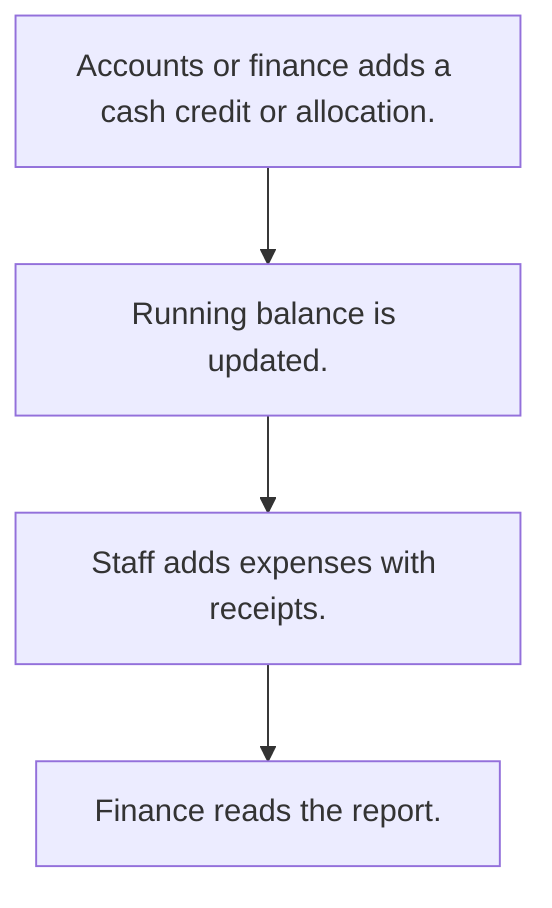

# Office petty cash

## Usual needs

- Usually has to record cash given to a person or received into the office.
- Usually has to let staff log small office expenses with category, mode and receipt photo.
- Usually has to keep a running cash balance per person.
- Usually has to show credits and expenses together for a date range.

## Process steps

1. Accounts or finance adds a cash credit or allocation.
2. Running balance is updated.
3. Staff adds expenses with receipts.
4. Finance reads the report.

## Usual sheets, key fields, roles

- Cash credit or allocation: Date, person, Amount, Remarks
- Office expense: Date, Category, Amount, Status, PaymentMode, receipt image
- Roles: Accounts or finance, office staff, Owner.

## Neome App / Delivery hint

Neome App: expense-management. Delivery: configuration. Hint only; grilling decides.

## Flowchart

