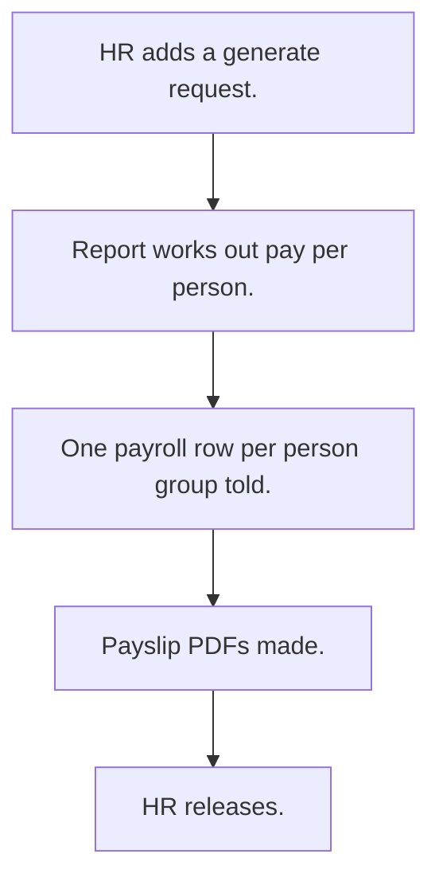

# Payroll

## Usual needs

- Usually has to let HR pick a month and year and make payroll rows for all staff.
- Usually has to use a different pay rule for workers.
- Usually has to work out earnings, deductions, loss-of-pay days and net pay.
- Usually has to make a payslip PDF per row.
- Usually has to mark payroll as generated or released.
- Usually has to sometimes keep a salary level table by year.

## Process steps

1. HR adds a generate request.
2. Report works out pay per person.
3. One payroll row per person; group told.
4. Payslip PDFs made.
5. HR releases.

## Usual sheets, key fields, roles

- Generate request: Year, Month, Days
- Payroll: Month, Year, Employee, earnings, deductions, LOPDays, net pay, amount in words, Payslip, PayrollStatus {Generated|Released}
- Roles: HR, Owner.

## Neome App / Delivery hint

Neome App: none in the catalog. Delivery: custom (pay rules are client-specific formulas). Hint only; grilling decides.

## Flowchart

