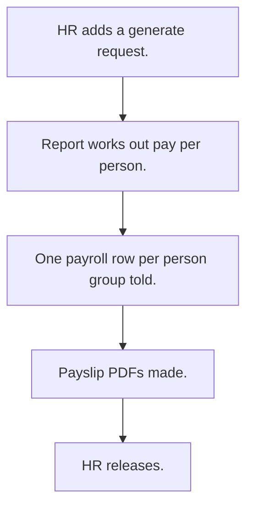

# Payroll

## Usual needs

- Usually has to let HR pick a month and year and make payroll rows for all staff.
- Usually has to use a different pay rule for workers.
- Usually has to work out earnings, deductions, loss-of-pay days and net pay.
- Usually has to make a payslip PDF per row.
- Usually has to mark payroll as generated or released.
- Usually has to sometimes keep a salary level table by year.

## Process steps

1. HR adds a generate request.
2. Report works out pay per person.
3. One payroll row per person; group told.
4. Payslip PDFs made.
5. HR releases.

## Usual sheets, key fields, roles

- Generate request: Year, Month, Days
- Payroll: Month, Year, Employee, earnings, deductions, LOPDays, net pay, amount in words, Payslip, PayrollStatus {Generated|Released}
- Roles: HR, Owner.

## Neome App / Delivery hint

Neome App: none in the catalog. Delivery: custom (pay rules are per-Enterprise formulas). Hint only; grilling decides.

## Flowchart

## Execute

Only use this to apply this into a Studio Enterprise via MCP.

Placeholders: PayrollRequest, Payroll, roles HR, Owner. Needs first: Employee sheet with pay fields (TMOD-employee-master).

1. Roles + vars: `add kind=role` HR, Owner; `add kind=var kind=setOfText name=PayrollStatusList deploy=fixedOnDeploy` keys Generated, Released.
2. Request form: `add kind=form name=PayrollRequest` → `kind=composite type=section` → fields `type=number` Year, `type=month` Month, `type=number` Days → `add kind=spreadsheet name=PayrollRequestSheet form=PayrollRequest insertRoles=[HR]` → `kind=spreadsheetLayout kind=table`.
3. Payroll form: section → `type=month` Month, `type=number` Year, `type=ref` Employee (`spreadsheet=EmployeeSheet`, list layout), `type=decimal` earnings, deductions, LOPDays, NetPay, `type=text` AmountInWords, `type=document` Payslip, `type=pickText source=PayrollStatusList` PayrollStatus → `PayrollSheet` (`updateRoles=[HR]`) → table layout.
4. Pay math: `apply PAT-calculated-field Execute` (formFormula on NetPay); worker rule = second formFormula with `condition{cond,negation}`. Defaults: `apply PAT-default-value-on-form Execute`.
5. Fan out: `apply PAT-fan-out-rows-from-report Execute` (workflow `eventSsInsertAfter spreadsheet=PayrollRequestSheet` → `executeReport` → iterate → `rowInsert spreadsheet=PayrollSheet` → `sendMessageToGroups`).
6. Payslip: `apply PAT-pdf-from-report Execute` (`generatePdf outputField=Payslip`). Optional link: `apply PAT-deeplink-to-form Execute`.
7. Actions + group: `add kind=action kind=rowInsert spreadsheet=PayrollRequestSheet`; `kind=spreadsheetEditor spreadsheet=PayrollSheet layoutSpreadsheet=PayrollTable` → `set kind=group actionPermissionMap` (HR, Owner).
8. Optional salary level sheet by year: form + `SalaryLevelSheet` + table layout.
9. `validate` till ok=true. `describe kind=workflow` to confirm edges.

Gaps: pay rules are per-Enterprise formulas (Open Item); report output iterate node (`branchIterateGrid` vs Array) (verify: describe); edgeMap entry keys unverified.
