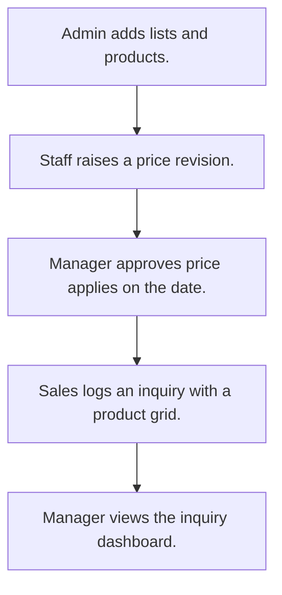

# Product catalog and inquiry

## Usual needs

- Usually has to keep a product master with category, sub category, type, unit, prices and images.
- Usually has to let staff ask for a selling price change that a manager approves.
- Usually has to apply the new price on its effective date and keep price history.
- Usually has to log a customer inquiry with the products and quantity wanted.
- Usually has to show inquiry counts for a date range.

## Process steps

1. Admin adds lists and products.
2. Staff raises a price revision.
3. Manager approves; price applies on the date.
4. Sales logs an inquiry with a product grid.
5. Manager views the inquiry dashboard.

## Usual sheets, key fields, roles

- Product: Name, Category, SubCategory, Type, Unit, CostPrice, Price, StockStatus, Status
- PriceRevision: Product ref, NewSellingPrice, EffectiveDate, ApprovalStatus, ApprovedBy
- ProductInquiry: Name, MobileNumber, Email, InquiryStatus, products grid with Quantity
- Roles: Inventory executive, Sales executive, Manager, Admin.

## Neome App / Delivery hint

Neome App: product-catalog. Delivery: standard (App gives it out of the box; only Neome App Build evidence so far, no client Build). Hint only; grilling decides.

## Flowchart

