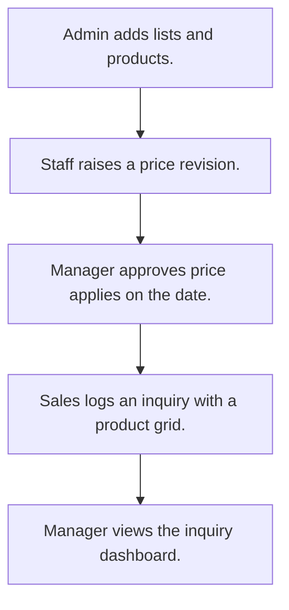

# Product catalog and inquiry

## Usual needs

- Usually has to keep a product master with category, sub category, type, unit, prices and images.
- Usually has to let staff ask for a selling price change that a manager approves.
- Usually has to apply the new price on its effective date and keep price history.
- Usually has to log a customer inquiry with the products and quantity wanted.
- Usually has to show inquiry counts for a date range.

## Process steps

1. Admin adds lists and products.
2. Staff raises a price revision.
3. Manager approves; price applies on the date.
4. Sales logs an inquiry with a product grid.
5. Manager views the inquiry dashboard.

## Usual sheets, key fields, roles

- Product: Name, Category, SubCategory, Type, Unit, CostPrice, Price, StockStatus, Status
- PriceRevision: Product ref, NewSellingPrice, EffectiveDate, ApprovalStatus, ApprovedBy
- ProductInquiry: Name, MobileNumber, Email, InquiryStatus, products grid with Quantity
- Roles: Inventory executive, Sales executive, Manager, Admin.

## Neome App / Delivery hint

Neome App: product-catalog. Delivery: standard (App gives it out of the box; only Neome App Build evidence so far, no Neome Build). Hint only; grilling decides.

## Flowchart

## Execute

Only use this to apply this into a Studio Enterprise via MCP.

Placeholders: Product, PriceRevision, ProductInquiry, roles InventoryExecutive, SalesExecutive, Manager, Admin. Needs first: none. If Neome App product-catalog is installed, `list` and reuse it; build only gaps.

1. Roles + vars: `add kind=role` x4; `add kind=var kind=setOfText` lists Category (or `kind=tree` for Category/SubCategory), Type, Unit, StockStatus, ApprovalStatus {Pending|Approved|Rejected}, InquiryStatus. Admin-kept lists: `apply PAT-admin-kept-pick-list Execute`.
2. Product form: section → `type=text` Name, `type=pickText source=...` Category, SubCategory, Type, Unit, StockStatus, Status, `type=decimal` CostPrice, Price, `type=image` Images → `ProductSheet` (`insertRoles=[Admin,InventoryExecutive]`, `historys=[Price]`) → table layout + list layout (for refs).
3. PriceRevision form: `type=ref` Product (`spreadsheet=ProductSheet`, list layout, `copyFieldMap`: `apply PAT-copy-fields-from-ref Execute`), `type=decimal` NewSellingPrice, `type=date` EffectiveDate, `type=pickText` ApprovalStatus, `type=pickUser` ApprovedBy (`roleIdDataSource=[Manager]`) → `PriceRevisionSheet` → table layout.
4. Approval: `apply PAT-approval-by-status Execute`; lock fields after approve: `apply PAT-lock-fields-by-visibility Execute`; show fields by status: `apply PAT-show-field-by-value Execute`.
5. Apply price on date: `apply PAT-per-row-scheduler Execute` (scheduler at EffectiveDate) + `apply PAT-update-linked-rows Execute` (`rowUpdate` ProductSheet Price). Price history: `apply PAT-sheet-history-action Execute`.
6. ProductInquiry form: section → `type=text` Name, `type=mobileNumber`, `type=email`, `type=pickText` InquiryStatus; `kind=composite type=grid` Products → `type=ref` Product, `type=number` Quantity: `apply PAT-line-items-grid-with-totals Execute` → `ProductInquirySheet` → table layout.
7. Messages: `apply PAT-message-on-event Execute` (revision raised → Manager; approved → asker).
8. Dashboard: `apply PAT-query-report-with-filter Execute` (inquiry counts, dateRange input) + `apply PAT-composite-report Execute`.
9. Actions + group: `kind=rowInsert` / `kind=spreadsheetEditor` per sheet, `kind=report` → `set kind=group actionPermissionMap` (roles on every entry).
10. `validate` till ok=true.

Gaps: tree var value shape for Category/SubCategory (verify: describe); scheduler-at-date node shape (verify: describe).
