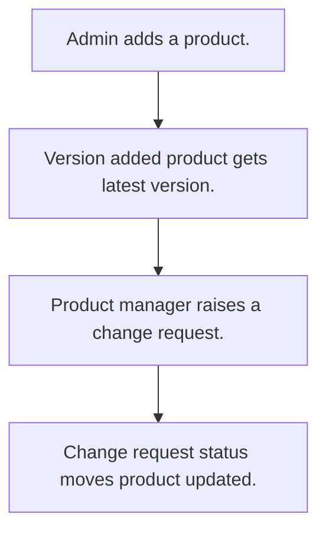

# Product versions and change requests

## Usual needs

- Usually has to keep a product master with code, tax details and stock status.
- Usually has to record each product version with reason and files.
- Usually has to show the latest version on the product.
- Usually has to raise a change request on a product with impact analysis and status.

## Process steps

1. Admin adds a product.
2. Version added; product gets latest version.
3. Product manager raises a change request.
4. Change request status moves; product updated.

## Usual sheets, key fields, roles

- Product: ProductName, ProductCode, tax code, tax percent, LatestVersion, StockStatus, images
- ProductVersion: Product, VersionNumber, ChangeReason, Attachments
- ChangeRequest: Product ref, RequestDate, Status, Reason, ImpactAnalysis, Attachments
- Roles: Product manager, Operations manager, Admin.

## Neome App / Delivery hint

Neome App: product-lifecycle-management. Delivery: standard (App gives it out of the box; only Neome App Build evidence so far, no client Build). Hint only; grilling decides.

## Flowchart

