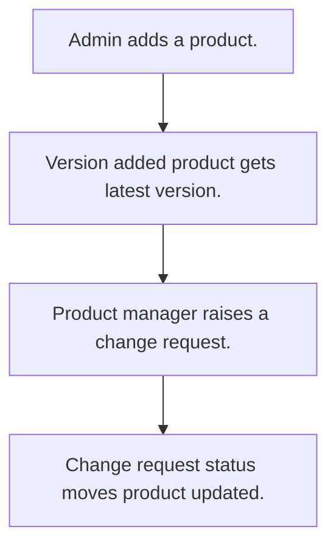

# Product versions and change requests

## Usual needs

- Usually has to keep a product master with code, tax details and stock status.
- Usually has to record each product version with reason and files.
- Usually has to show the latest version on the product.
- Usually has to raise a change request on a product with impact analysis and status.

## Process steps

1. Admin adds a product.
2. Version added; product gets latest version.
3. Product manager raises a change request.
4. Change request status moves; product updated.

## Usual sheets, key fields, roles

- Product: ProductName, ProductCode, tax code, tax percent, LatestVersion, StockStatus, images
- ProductVersion: Product, VersionNumber, ChangeReason, Attachments
- ChangeRequest: Product ref, RequestDate, Status, Reason, ImpactAnalysis, Attachments
- Roles: Product manager, Operations manager, Admin.

## Neome App / Delivery hint

Neome App: product-lifecycle-management. Delivery: standard (App gives it out of the box; only Neome App Build evidence so far, no Neome Build). Hint only; grilling decides.

## Flowchart

## Execute

Only use this to apply this into a Studio Enterprise via MCP.

Placeholders: Product, ProductVersion, ChangeRequest, roles ProductManager, OperationsManager, Admin. Needs first: none. If Neome App product-lifecycle-management is installed, `list` and reuse it; build only gaps.

1. Roles + vars: `add kind=role` x3; `add kind=var kind=setOfText` StockStatus, ChangeRequestStatus (e.g. Open, InReview, Approved, Rejected, Done).
2. Product form: section → `type=text` ProductName, `type=symbol` ProductCode, `type=text` TaxCode, `type=decimal` TaxPercent, `type=text` LatestVersion (`disabled=true`), `type=pickText` StockStatus, `type=image` Images → `ProductSheet` (`insertRoles=[Admin]`) → table + list layouts.
3. ProductVersion form: `type=ref` Product (`spreadsheet=ProductSheet`, list layout), `type=text` VersionNumber, `type=paragraph` ChangeReason, `type=setOfDocument` Attachments → `ProductVersionSheet` → table layout.
4. Latest version: `apply PAT-update-linked-rows Execute` (`eventSsInsertAfter spreadsheet=ProductVersionSheet` → `rowUpdate` ProductSheet LatestVersion).
5. ChangeRequest form: `type=ref` Product (`apply PAT-copy-fields-from-ref Execute`), `type=date` RequestDate, `type=pickText` Status, `type=paragraph` Reason, ImpactAnalysis, `type=setOfDocument` Attachments → `ChangeRequestSheet` (`updateRoles=[ProductManager,OperationsManager]`) → table layout.
6. Form logic: `apply PAT-show-field-by-value Execute`, `apply PAT-lock-fields-by-visibility Execute`, `apply PAT-calculated-field Execute` as needed.
7. Status → product update: `apply PAT-update-linked-rows Execute` (`eventSsUpdateAfter spreadsheet=ChangeRequestSheet`). App user from row: `apply PAT-sheet-row-drives-app-user Execute` only if asked.
8. Actions + group: `kind=rowInsert` / `kind=spreadsheetEditor` per sheet → `set kind=group actionPermissionMap` (roles on every entry).
9. `validate` till ok=true.

Gaps: which product fields a done change request updates (Open Item).
