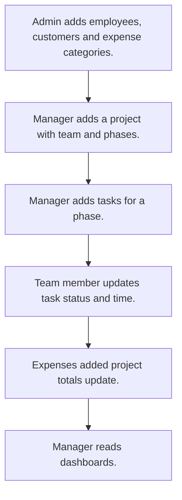

# Project management

## Usual needs

- Usually has to set up a project with customer, team, phases, priority and budget.
- Usually has to add tasks for a phase and team member, with time and status.
- Usually has to work out time taken, delay and billable cost per task.
- Usually has to log expenses against a project with category and files.
- Usually has to keep project totals of tasks, hours, expenses and cost.
- Usually has to show project and task dashboards.

## Process steps

1. Admin adds employees, customers and expense categories.
2. Manager adds a project with team and phases.
3. Manager adds tasks for a phase.
4. Team member updates task status and time.
5. Expenses added; project totals update.
6. Manager reads dashboards.

## Usual sheets, key fields, roles

- Project: Customer ref, Priority, Status, team grid with rates, phase grid, ContractValue, BudgetCost, ActualCost, totals (log numbers)
- Task: Project ref, phase, TeamMember, ETC, TimeTaken, Status
- Expense: Project ref, Category, Amount, Documents
- Customer and ExpenseCategory lists
- Roles: Project manager, Team member, Admin.

## Neome App / Delivery hint

Neome App: project-management. Delivery: standard (App gives it out of the box; only Neome App Build evidence so far, no client Build). Hint only; grilling decides.

## Flowchart

