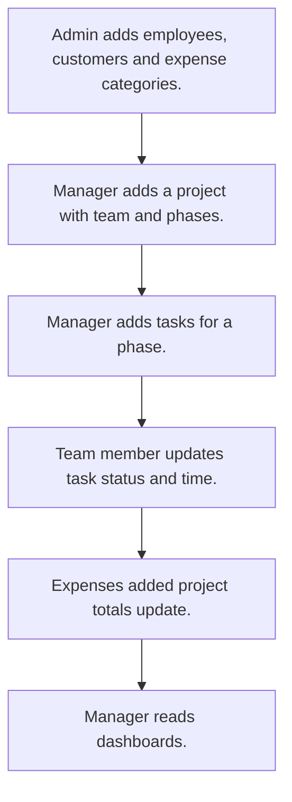

# Project management

## Usual needs

- Usually has to set up a project with customer, team, phases, priority and budget.
- Usually has to add tasks for a phase and team member, with time and status.
- Usually has to work out time taken, delay and billable cost per task.
- Usually has to log expenses against a project with category and files.
- Usually has to keep project totals of tasks, hours, expenses and cost.
- Usually has to show project and task dashboards.

## Process steps

1. Admin adds employees, customers and expense categories.
2. Manager adds a project with team and phases.
3. Manager adds tasks for a phase.
4. Team member updates task status and time.
5. Expenses added; project totals update.
6. Manager reads dashboards.

## Usual sheets, key fields, roles

- Project: Customer ref, Priority, Status, team grid with rates, phase grid, ContractValue, BudgetCost, ActualCost, totals (log numbers)
- Task: Project ref, phase, TeamMember, ETC, TimeTaken, Status
- Expense: Project ref, Category, Amount, Documents
- Customer and ExpenseCategory lists
- Roles: Project manager, Team member, Admin.

## Neome App / Delivery hint

Neome App: project-management. Delivery: standard (App gives it out of the box; only Neome App Build evidence so far, no Neome Build). Hint only; grilling decides.

## Flowchart

## Execute

Only use this to apply this into a Studio Enterprise via MCP.

Placeholders: Project, Task, Expense, Customer, ExpenseCategory, roles ProjectManager, TeamMember, Admin. Needs first: Employee sheet (TMOD-employee-master). If Neome App project-management is installed, `list` and reuse it; build only gaps.

1. Roles + vars: `add kind=role` x3; `add kind=var kind=setOfText` Priority, ProjectStatus, TaskStatus. Admin lists: `apply PAT-admin-kept-pick-list Execute` (CustomerSheet, ExpenseCategorySheet, each with list layout).
2. Project form: section → `type=ref` Customer, `type=pickText` Priority, Status, `type=decimal` ContractValue, BudgetCost, ActualCost, `type=logNumber` TotalTasks, TotalHours, `type=logDecimal` TotalExpense, TotalCost; `kind=composite type=grid` Team (`type=pickUser roleIdDataSource=[TeamMember]`, `type=decimal` Rate); grid Phases (`type=text` Phase) → `ProjectSheet` → table + list layouts.
3. Task form: `type=ref` Project (`apply PAT-copy-fields-from-ref Execute`), phase pick (`apply PAT-pick-from-report-ref Execute`), `type=pickUser` TeamMember, `type=dateTime` ETC, `type=duration` TimeTaken, `type=pickText` Status → `TaskSheet` (`updateRoles=[TeamMember,ProjectManager]`) → table + kanban (`kanbanField=Status`) layouts.
4. Task math (delay, billable cost): `apply PAT-calculated-field Execute`; bad entries: `apply PAT-error-field-check Execute`; `apply PAT-show-field-by-value Execute`.
5. Expense form: `type=ref` Project, `type=ref` Category, `type=decimal` Amount, `type=setOfDocument` Documents → `ExpenseSheet` → table layout.
6. Totals: `apply PAT-running-total-by-log-field Execute` (`rowUpdateFieldLogNumber` on ProjectSheet from Task/Expense events). Status moves: `apply PAT-act-on-status-change Execute`.
7. Dashboards: `apply PAT-query-report-with-filter Execute` + `apply PAT-composite-report Execute`. Team app user: `apply PAT-sheet-row-drives-app-user Execute` if asked.
8. Actions + group: `kind=rowInsert` / `kind=spreadsheetEditor` per sheet, `kind=report` → `set kind=group actionPermissionMap` (roles on every entry).
9. `validate` till ok=true.

Gaps: phase pick from Project grid (report-backed ref) shape (verify: describe).
